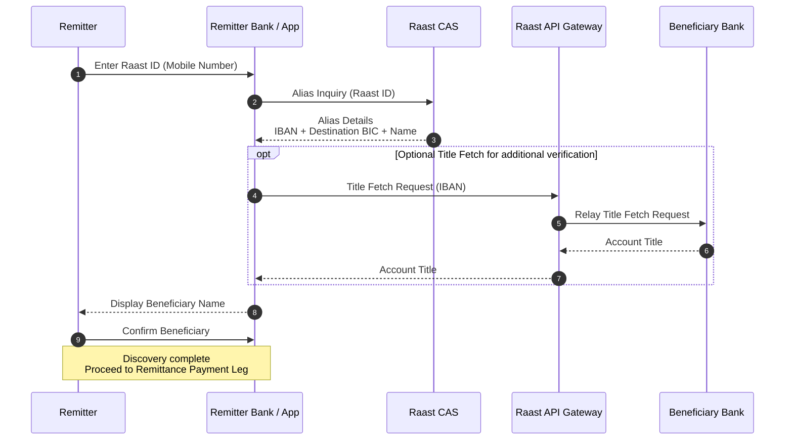
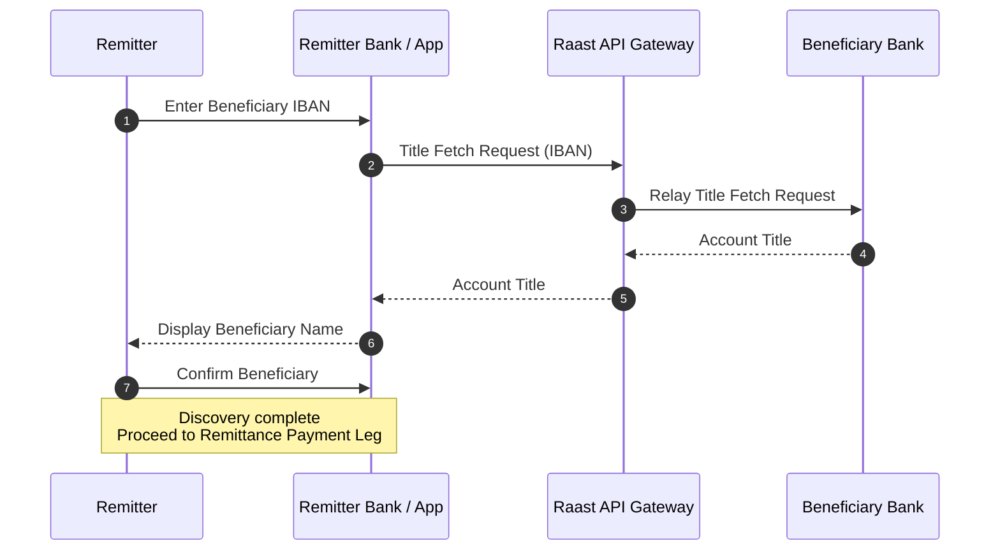
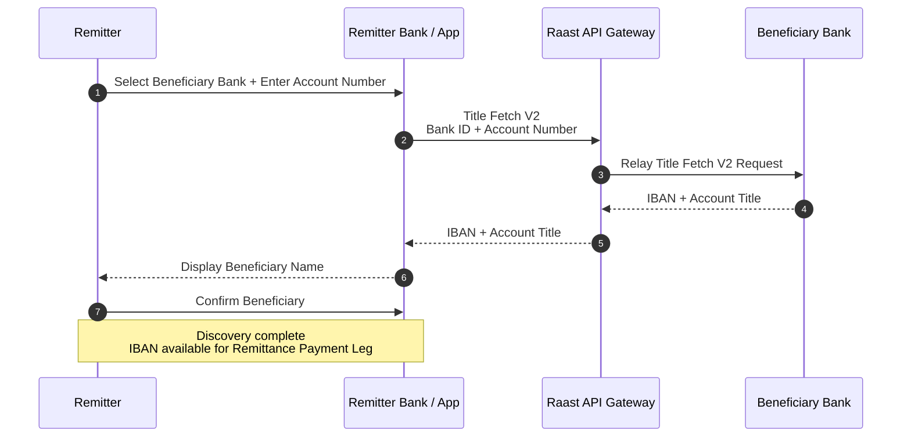
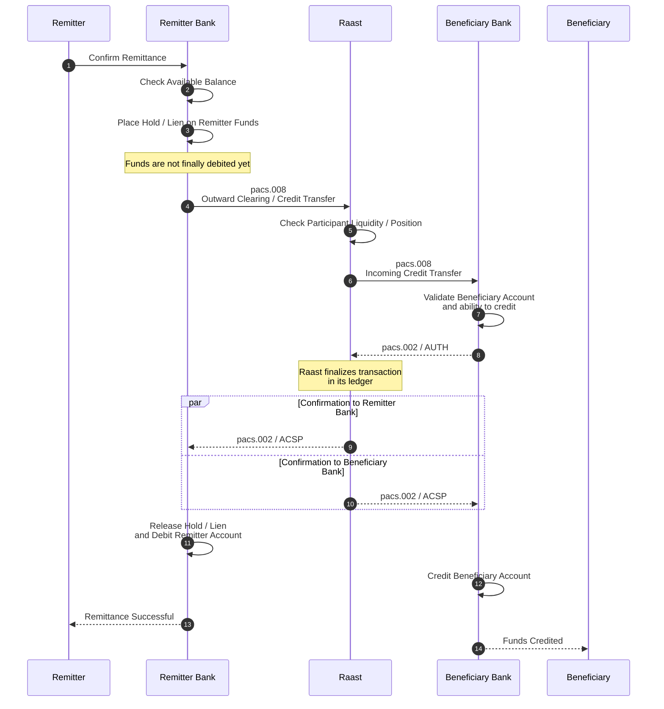
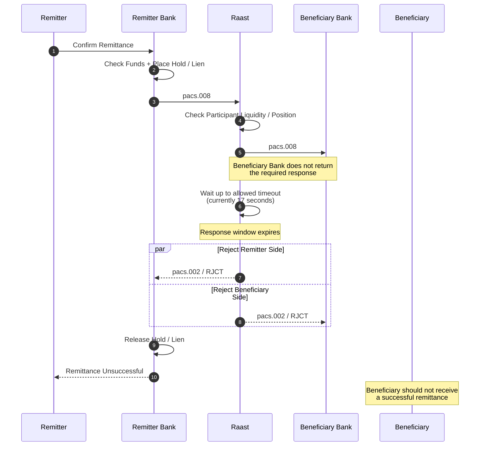
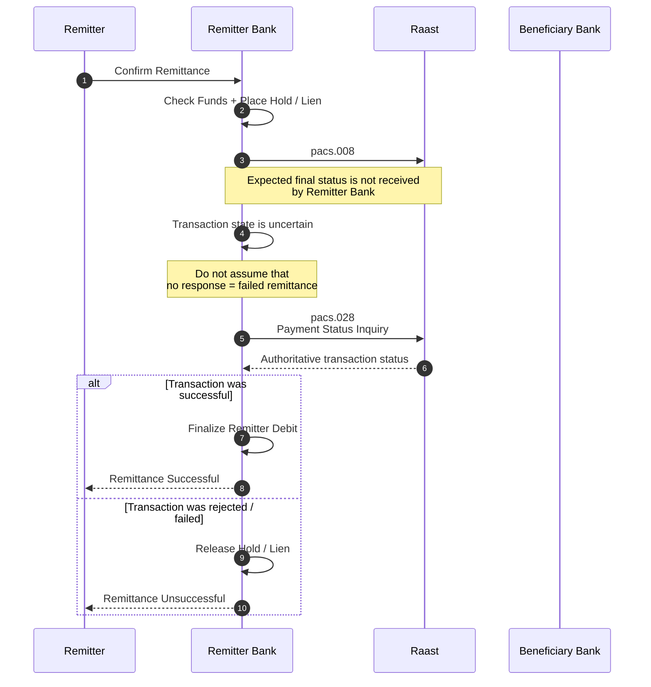
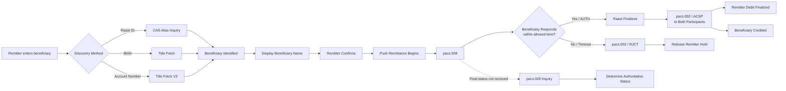

# Module 2 — Raast P2P Remittance: An Overview

This module follows the same discovery and payment flow as [Module 1 — Raast P2P Payment](../01-p2p/01_Raast_P2P_Payment_Overview.md). A remittance on this flow is still a Raast push payment. The change is the business wording: a **remitter** sends funds to a **beneficiary**.

Beneficiary discovery is the same. The remitting institution can identify the beneficiary with a Raast ID (alias), an IBAN, or a legacy account number, and can verify the account title before the remittance is sent. Message names, the hold/lien, the 17-second response window, and the uncertain-state handling below are the same behaviors already described in Module 1. This overview does not define a separate remittance message set.

## Learning objectives

By the end of this module, a new technical employee should be able to:

- Explain a Raast P2P remittance from the remitter's perspective and from the system perspective.
- Explain why Raast ID exists and the role of the Centralized Alias Service (CAS) when the beneficiary is identified by an alias.
- Distinguish discovery using Raast ID, IBAN, and legacy account number.
- Explain why beneficiary/title verification occurs before the remittance is initiated.
- Describe the normal remittance flow using `pacs.008`, `pacs.002/AUTH`, and `pacs.002/ACSP`.
- Explain why a P2P remittance is a **push payment**.
- Recognize timeout and uncertain-state scenarios.
- Explain the role of `pacs.002/RJCT` and `pacs.028` in exception handling.

---

## 1. Start with the customer experience

Most employees joining a bank, fintech, remittance company, DevOps team, or Application Reliability Engineering team have already seen a remittance arrive in a bank or wallet application without necessarily knowing what happens underneath.

A typical P2P remittance journey starts when a **remitter** wants to send funds to a **beneficiary**. A bank or wallet application commonly allows the remitter to identify the beneficiary using one of three methods:

1. **Raast ID** — currently commonly the beneficiary's registered mobile number.
2. **IBAN** — the beneficiary's International Bank Account Number.
3. **Account Number** — a legacy/local account number together with the destination institution.

Before the remittance is sent, Raast supports the same **discovery/verification leg** used for a normal P2P payment. Its purpose is to help the remitter identify and confirm the intended beneficiary. Title verification can start from an alias, an IBAN, or a legacy account number.

A useful mental model is:

> **Discovery answers: “Who is receiving this remittance?”**  
> **The remittance payment answers: “Can these funds be transferred and finalized?”**

The remitting institution plays the same role the payer's bank plays in Module 1. It accepts the remitter's instruction, discovers the beneficiary, and sends the payment on Raast. The beneficiary's institution plays the same role as the payee's bank.

---

# Part A — Discovery and Beneficiary Verification

## 2. Why Raast ID exists

Bank account numbers and IBANs are not particularly easy for people to remember or communicate, including when a remitter is trying to identify a beneficiary. Raast therefore supports an **alias** that can be associated with a beneficiary's bank account.

Raast maintains a **Centralized Alias Service (CAS)**. Conceptually, CAS is a centralized directory that holds alias registrations and the information needed to resolve an alias to the beneficiary's destination account/institution.

The alias capability can support multiple alias types. In the current operating model covered by this training, the practical relationship is **one customer / one account / one alias**, and the commonly used Raast ID is the customer's mobile number.

A beneficiary registers a Raast ID through their participating bank or institution and links it to the bank account of their choice. The participant registers the association with CAS. Thereafter, the remitting participant can perform an **Alias Inquiry** using the Raast ID and obtain the information required to identify and route the remittance toward the destination account, including the IBAN, destination BIC and beneficiary information.

This is what makes it possible for a remitter to provide a familiar mobile number rather than a long IBAN.

---

## 3. Discovery using Raast ID / Alias

The remitter enters the beneficiary's Raast ID. The remitting institution performs an Alias Inquiry against CAS. The result provides the destination information and beneficiary name. A Title Fetch may additionally be performed for verification, using the IBAN returned by CAS.

### Engineering takeaway

A **Raast ID is an alias, not the actual destination account number**. CAS resolves the easy-to-remember alias into information that can be used for beneficiary identification and subsequent remittance routing. An optional Title Fetch can still be used after the alias is resolved.

---

## 4. Discovery using IBAN

When the remitter already has the beneficiary's IBAN, there is no alias to resolve through CAS. The remitting institution can use Raast's API Gateway to perform a **Title Fetch** from the destination institution.

### Engineering takeaway

CAS is not needed for this journey because there is no alias to resolve. The Title Fetch allows the remitter to see the beneficiary name before authorizing the remittance.

---

## 5. Discovery using legacy Account Number

A remitter may also identify a beneficiary using a bank/institution plus a legacy account number rather than an IBAN. Raast provides another Title Fetch variant, referred to in this training as **Title Fetch V2**.

The request contains the destination bank/institution identifier and account number. The response can provide both the **IBAN** and **account title**.

---

## 6. The three discovery methods at a glance

| Remitter knows | Primary discovery mechanism | Main result |
|---|---|---|
| Raast ID / mobile alias | CAS Alias Inquiry | IBAN, destination BIC and beneficiary information; optional Title Fetch |
| IBAN | Title Fetch | Account title |
| Bank + Account Number | Title Fetch V2 | IBAN + account title |

Regardless of the discovery method, the objective is to show the remitter who will receive the funds **before the remitter confirms the remittance**. Alias, IBAN, and legacy account number are all valid ways to reach that title check.

---

# Part B — The Remittance Payment Leg

## 7. A P2P remittance is a push payment

A Raast P2P remittance is a **push payment**, the same pattern as a normal P2P payment. The remitter initiates and authorizes the transfer of funds toward the beneficiary.

This distinction is important. The remittance does not begin merely because the beneficiary exists. The remitter selects the beneficiary, sees the beneficiary information returned during discovery, confirms the intended beneficiary and then instructs their institution to send the funds.

---

## 8. ISO 20022 and Raast messages

Raast uses **ISO 20022** messaging for this remittance flow, just as it does for a normal P2P payment. ISO 20022 is a structured financial messaging standard used to exchange payment and related financial information between systems and institutions.

For engineers who have previously worked with card payments, a useful comparison is that card ecosystems have historically made extensive use of **ISO 8583**, whereas modern account-to-account payment infrastructures commonly use ISO 20022 messages.

In the basic successful remittance flow introduced in this module, the important messages are the same ones introduced in Module 1:

- **`pacs.008`** — the credit transfer / clearing message carrying the remittance payment instruction.
- **`pacs.002/AUTH`** — the beneficiary participant's response to Raast indicating that it can accept/authorize the incoming remittance in the flow described here.
- **`pacs.002/ACSP`** — the successful status sent **by Raast to both participants** after Raast finalizes the transaction in its ledger.
- **`pacs.002/RJCT`** — a rejected payment status.
- **`pacs.028`** — an inquiry/status investigation mechanism used when the sending participant does not know the final outcome of the remittance.

---

## 9. Normal successful P2P remittance flow

After beneficiary discovery and remitter confirmation, the remittance payment leg begins.

The remitting institution first verifies that the remitter has sufficient funds. It places a hold/lien on the funds rather than immediately treating the remittance as finally completed. It then sends the payment to Raast using `pacs.008`.

Raast checks the sending participant's available liquidity/position in the Raast ledger. If sufficient liquidity is available, the payment is forwarded to the beneficiary institution.

The beneficiary institution validates the beneficiary account and its ability to credit the remittance. It responds to Raast with `pacs.002/AUTH`.

Once the transaction is finalized in the Raast ledger, **Raast sends `pacs.002/ACSP` to both the remitting and beneficiary participants**. The remitting institution can then finalize the remitter's debit/release the hold as applicable, while the beneficiary institution credits the beneficiary.

---

# Part C — Exceptions and Uncertain Outcomes

## 10. Think like an Application Reliability Engineer

A remittance diagram showing only the happy path is not enough for someone responsible for production reliability.

At each network hop, engineers should ask:

- What happens if the destination system is unavailable?
- What happens if a request reaches the destination but the response does not return?
- What happens if processing exceeds the allowed time?
- What happens if one participant thinks the remittance failed while another has processed it?
- When is it safe to release a remitter's held funds?
- How does the sender determine the authoritative final status?

The distinction between a **known failure** and an **unknown outcome** is fundamental to remittance operations.

---

## 11. Exception scenario — Beneficiary participant timeout

Consider a remittance where Raast successfully sends the `pacs.008` to the beneficiary institution, but the beneficiary institution does not provide the required response within the permitted response window.

For the operating flow covered by this training, the response timeout is **17 seconds**, the same window documented for the P2P flow in Module 1.

Raast cannot wait indefinitely for the receiving participant. If the required response is not received within the allowed time, Raast rejects the transaction and communicates the rejection using `pacs.002/RJCT`.

### Reliability lesson

A timeout is not simply “the application was slow.” In an instant-payment system, response deadlines are part of the transaction protocol and can determine whether a remittance succeeds or is rejected.

---

## 12. Exception scenario — Remitting participant receives no final status

A more subtle situation occurs when the remitting institution sends a remittance but receives **neither an acceptance nor a rejection**.

This can happen because of a network interruption, dropped response, connection problem, middleware failure or another communication issue. The absence of a response does **not automatically prove that the remittance failed**.

For example, Raast may have processed the transaction and sent a final status, but the response may not have reached the remitting institution.

The sending institution therefore needs a way to determine the authoritative state before deciding what to do with the remitter's held funds. Raast provides the **`pacs.028` inquiry mechanism** for this purpose.

> **Important:** This diagram intentionally introduces `pacs.028` at a conceptual level. Detailed `pacs.028` response handling, retry rules, timing, message correlation and additional exception cases should be covered in the subsequent operations/reliability module.

---

## 13. Why the hold/lien matters

The remitting institution must manage the remitter's balance carefully while the distributed remittance is being processed.

If it immediately releases funds simply because it did not receive a response, it risks allowing the remitter to spend money that may already have been successfully transferred through Raast.

Conversely, if the remittance is definitively rejected, the remitter should not remain deprived of those funds unnecessarily.

This is why engineers must distinguish between:

- **Success** — an authoritative successful status is known.
- **Failure / Rejection** — an authoritative rejected status is known.
- **Unknown / Uncertain** — the participant does not yet know the authoritative final outcome.

The third state is particularly important for Application Reliability, Operations and Support engineers.

---

# 14. End-to-end mental model

---

# 15. Key terms

| Term | Meaning in this module |
|---|---|
| Remitter | Person sending the remittance. Same role as the payer in Module 1 |
| Beneficiary | Person receiving the remittance. Same role as the payee in Module 1 |
| Participant | Bank or institution connected to Raast |
| Raast ID | Easy-to-remember alias linked to an account; commonly a mobile number |
| CAS | Centralized Alias Service used to register and resolve aliases |
| BIC | Bank/Business Identifier Code used to identify the destination institution |
| Title Fetch | API-based beneficiary account-title verification. Can follow an alias resolution or start from an IBAN |
| Title Fetch V2 | Variant supporting bank/institution + legacy account number and returning IBAN/title |
| Push Payment | Remittance initiated by the remitter to send funds to the beneficiary |
| ISO 20022 | Structured financial messaging standard used by Raast |
| `pacs.008` | Credit transfer / clearing instruction |
| `pacs.002/AUTH` | Beneficiary participant authorization/acceptance response in this flow |
| `pacs.002/ACSP` | Successful processing status sent by Raast to both participants after finalization |
| `pacs.002/RJCT` | Rejected payment status |
| `pacs.028` | Payment status inquiry mechanism used to resolve an uncertain transaction state |
| Hold / Lien | Reservation of remitter funds while the remittance outcome is being determined |
| Liquidity / Position | Funds available to a participant within the Raast settlement/ledger mechanism |

---

# 16. What a new technical employee should remember

1. **Discovery happens before the remittance is sent.**
2. **Raast ID is an alias** designed to make beneficiary identification easier.
3. **CAS resolves aliases**; Title Fetch verifies beneficiary information through participating institutions.
4. **Alias, IBAN, and account-number discovery do not all use the same path.** Alias goes through CAS, with an optional Title Fetch. IBAN uses Title Fetch. A legacy account number uses Title Fetch V2.
5. A Raast P2P remittance is a **push payment** initiated by the remitter.
6. The remitting institution normally reserves/holds funds before sending the payment instruction.
7. **`pacs.008` carries the remittance payment instruction.**
8. The beneficiary participant responds to Raast with **`pacs.002/AUTH`** in the successful flow described here.
9. After finalization, **Raast sends `pacs.002/ACSP` to both participants**.
10. If the beneficiary participant does not respond within the permitted window (currently **17 seconds** for the flow covered here), Raast rejects the transaction using **`pacs.002/RJCT`**.
11. **No response is not the same as rejection.** If the remitting institution does not know the final status, it must resolve the uncertainty rather than blindly releasing funds.
12. **`pacs.028` provides a status inquiry mechanism** for uncertain remittance outcomes.

---

## Reflection before the assessment

Before continuing, think about the remittance as a distributed system. Identify at least five points where a failure could occur and ask yourself whether each failure would create a **known rejection** or an **unknown transaction state**.

That distinction will become increasingly important in the next modules on exception handling, operations, observability and troubleshooting.
