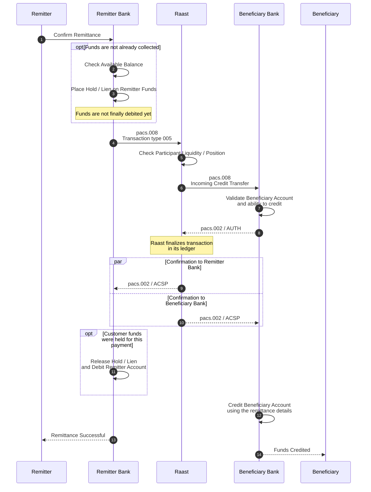
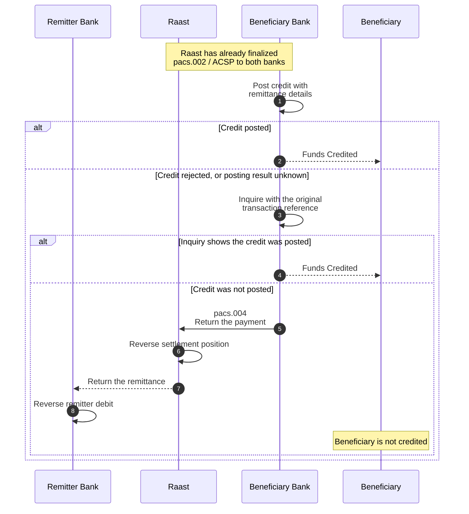
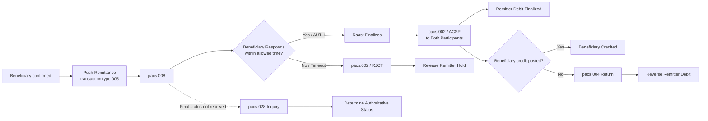

# Module 2 — Raast P2P Remittance: An Overview

Read [Module 1 — Raast P2P Payment](../01-p2p/01_Raast_P2P_Payment_Overview.md) first. Discovery, the push-payment pattern, the shared Raast messages, the 17-second timeout, and the `pacs.028` inquiry are explained there. This module covers only what is different for a home remittance.

A normal P2P payment uses transaction type **001**. A remittance uses transaction type **005**. With 005, the payment also says which institution sent the money, which country it came from, and how foreign currency was converted into the rupee credit. The beneficiary bank uses those facts when it posts the credit. The sending bank uses them to support the electronic proceeds realization certificate (e-PRC).

## Learning objectives

By the end of this module, a new technical employee should be able to:

- Explain a home remittance from the remitter's perspective and from the system perspective.
- Distinguish a normal P2P payment (transaction type 001) from a remittance (transaction type 005).
- Explain when the sending bank places a customer hold, and when the tie-up has already collected the funds.
- Describe the successful remittance flow, including the extra details posted with the credit.
- Explain the return with `pacs.004` when the beneficiary credit cannot be posted.

---

## 1. What a home remittance is

A home remittance is money sent from abroad, through a tie-up or money-transfer arrangement, to a person in Pakistan. The bank may pay it in cash over the counter, credit its own customer, or credit an account at another bank or an m-wallet.

Raast is the real-time path for that last case. The bank sends the credit as a Raast payment so the beneficiary is paid immediately.

The beneficiary is identified in the same three ways as Module 1. A tie-up uses that same title check before the funds move.

| Remitter knows | Where this is covered | Main result |
|---|---|---|
| Raast ID / mobile alias | [Module 1, alias discovery](../01-p2p/01_Raast_P2P_Payment_Overview.md) | IBAN, destination BIC and beneficiary information; optional Title Fetch |
| IBAN | Module 1, Title Fetch | Account title |
| Bank + Account Number | Module 1, Title Fetch V2 | IBAN + account title |

> **Discovery answers: “Who is receiving this remittance?”**  
> **The remittance payment answers: “Can these funds be transferred and finalized?”**

---

## 2. What changes on the payment

The message names do not change. Module 1 defines `pacs.008`, `pacs.002/AUTH`, `pacs.002/ACSP`, `pacs.002/RJCT`, and `pacs.028`. A remittance adds two things.

The marker inside the payment:

- **Transaction type 001** — a normal P2P transfer.
- **Transaction type 005** — a remittance. The payment also carries the remitting institution, the country it came from, and the foreign-currency amount and conversion into rupees.

How the sending bank starts that payment:

- The bank still has to take the money from its customer. It checks the balance and places a hold, the same hold described in Module 1, then sends the payment.
- The tie-up has already collected the funds. The bank does not place a new customer hold. It sends the credit so another bank or m-wallet can pay the beneficiary.

If the beneficiary institution cannot validate the account, it declines the payment. Raast rejects it to both participants with `pacs.002/RJCT`, and any sender hold is released. A beneficiary that does not answer within the 17-second window in Module 1 is rejected the same way. If the sending bank never receives a final status, it uses the same `pacs.028` inquiry rather than guessing.

The remittance-specific exception is later: a credit that cannot be posted after Raast has already accepted the payment is returned with `pacs.004`.

---

## 3. Normal successful remittance flow

After the beneficiary is confirmed, the bank sends `pacs.008` marked as transaction type **005**. It places a hold only when it still has to debit its customer.

Raast checks the sending participant's position and forwards the payment. The beneficiary institution validates the account and responds with `pacs.002/AUTH`. After Raast finalizes the transaction, it sends `pacs.002/ACSP` to both participants. The sending bank then completes any customer debit it had held, and the beneficiary institution posts the credit with the remittance details.

---

## 4. When the beneficiary credit does not post

`pacs.002/ACSP` means Raast has finalized the payment between the two participants. The beneficiary institution then posts the credit, including the extra remittance details when the transaction type is **005**.

If that posting is rejected, or the institution cannot tell whether it posted, the result is not left open. The institution inquires with the original transaction reference. When the credit was not posted, it returns the payment with `pacs.004`. Raast reverses the settlement position, and the sending institution reverses the remitter.

A missing posting response is not yet success or failure. The inquiry has to come back first.

---

## 5. End-to-end mental model

Discovery is the Module 1 path. From confirmation onward, a remittance looks like this:

The timeout and the `pacs.028` inquiry are the same uncertain-state cases as Module 1. The return after a failed credit post is the step Module 1 does not cover.

---

## 6. Terms that are specific to this module

Shared terms such as Raast ID, Title Fetch, `pacs.008`, and hold/lien are defined in Module 1.

| Term | Meaning in this module |
|---|---|
| Remitter | Person sending the remittance. Same role as the payer in Module 1 |
| Beneficiary | Person receiving the remittance. Same role as the payee in Module 1 |
| Tie-up | Partner or money-transfer arrangement that delivers the home remittance to the bank |
| Transaction type 001 | Normal P2P transfer |
| Transaction type 005 | Remittance. Also carries the remittance origin and conversion details |
| e-PRC | Electronic proceeds realization certificate supported by those remittance details |
| `pacs.004` | Return of a payment whose beneficiary credit could not be posted |

---

## 7. What to remember

1. Read the shared discovery and payment behavior in **Module 1**. Alias, IBAN, and account-number title checks are unchanged.
2. A remittance is transaction type **005**. A normal P2P payment is **001**.
3. Hold the customer's funds only when the bank still has to debit them. If the tie-up has already collected the money, send the credit without a new hold.
4. **`pacs.008` carries the remittance**, including the origin and conversion details used for the credit and for e-PRC.
5. If the beneficiary credit cannot be posted, the payment is **returned with `pacs.004`**. A missing posting response is not yet a successful customer credit.
