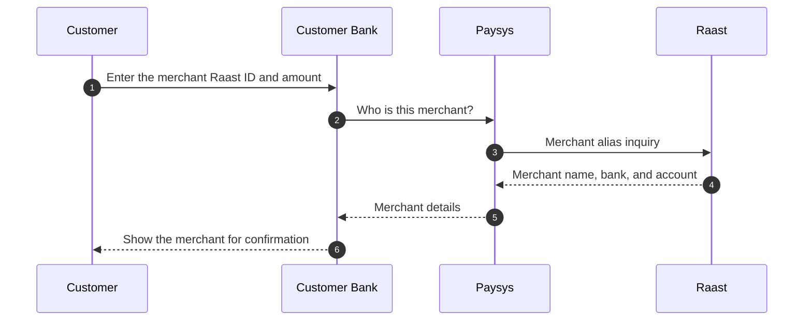
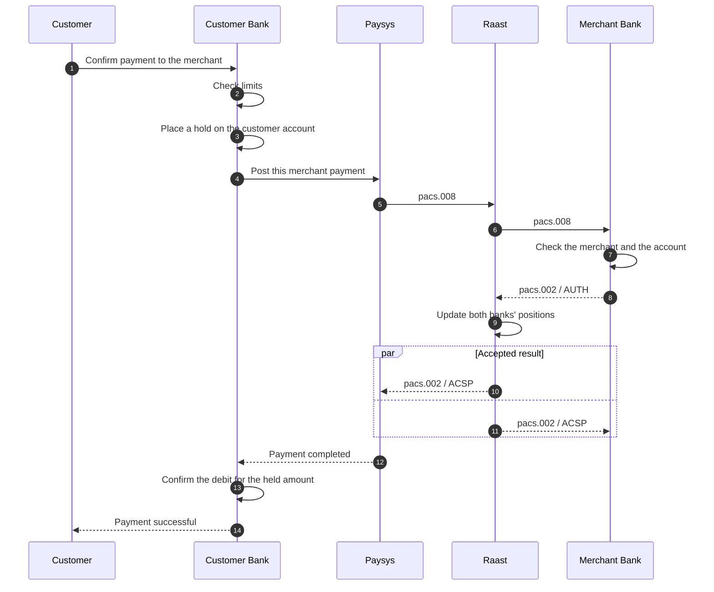
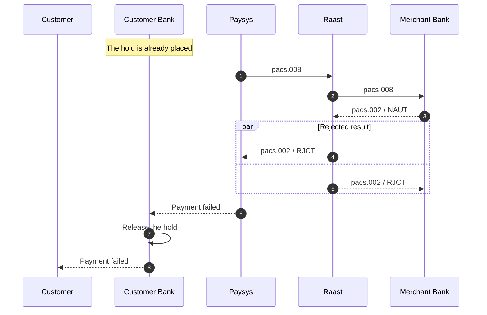
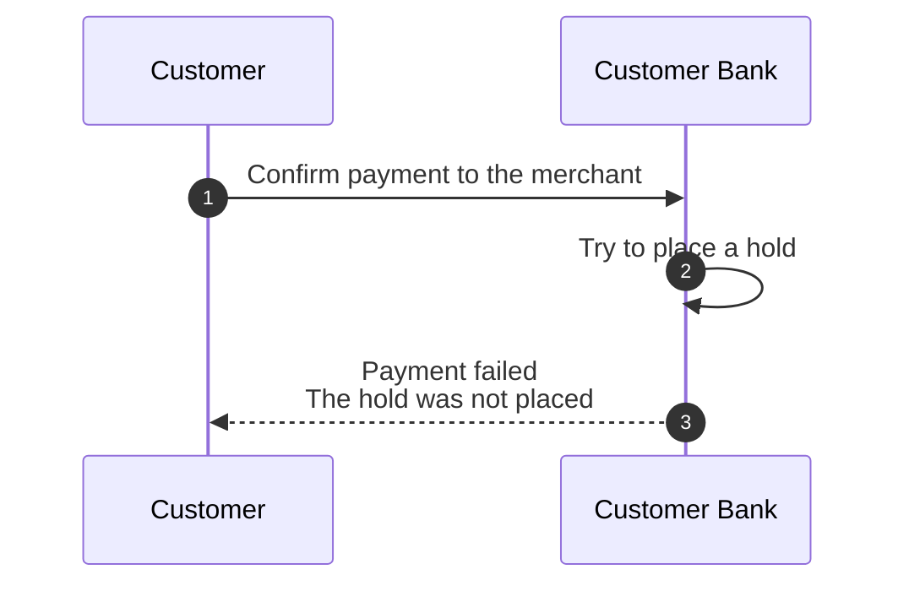
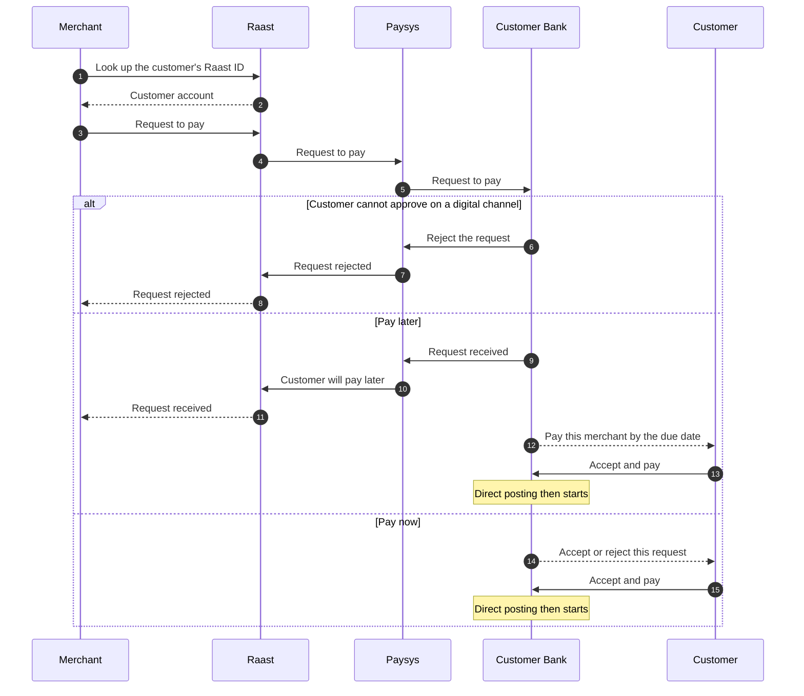
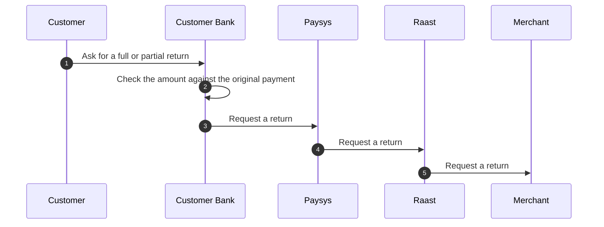
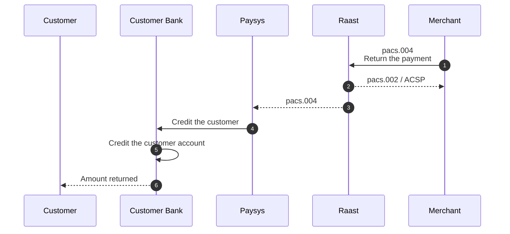
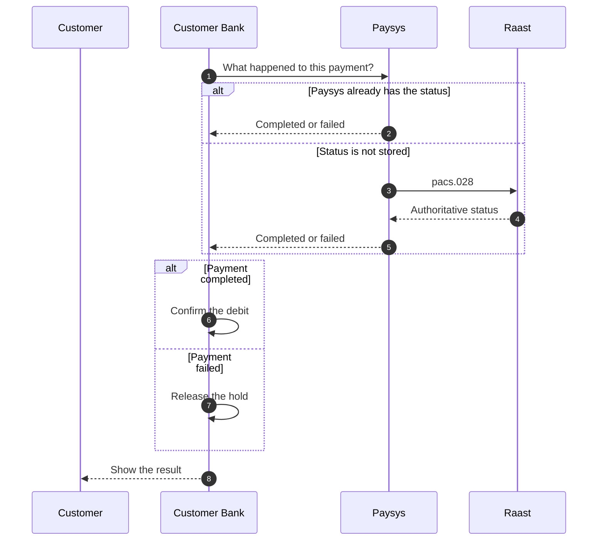
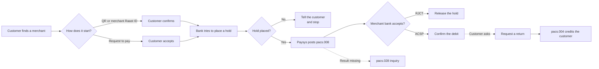

# Module 3 — Raast P2M Issuing: An Overview

Read [Module 1 — Raast P2P Payment](../01-p2p/01_Raast_P2P_Payment_Overview.md) first. That module is one person paying another person. P2M issuing is the customer's bank paying a merchant.

This page is direct posting. The customer's bank places the hold and later confirms the debit. Paysys posts the payment to Raast. The merchant's bank is covered in [P2M Acquiring](../04-p2m-acquiring/04_Raast_P2M_Acquiring_Overview.md).

A scanned QR that belongs to a person follows Module 1. A merchant QR stays in this module.

## Learning objectives

By the end of this module, a new technical employee should be able to:

- Explain how a customer pays a merchant by QR or by the merchant's Raast ID.
- Describe the successful direct-posting payment, from the hold to the confirmed debit.
- Explain what happens when Raast rejects the payment, and when the bank cannot place the hold.
- Describe a merchant's request to pay, including pay now and pay later.
- Explain a customer's request for a return, and the inquiry used when the result is missing.

---

## 1. What this module adds

The customer starts the payment, or the merchant asks the customer to pay. Either way, the customer's bank is the issuer. It checks the customer, holds the money, and confirms the debit only after Raast accepts the payment.

Paysys is the Open Connect service between that bank and Raast. Raast sends the payment to the merchant's bank. The merchant's bank checks the merchant and answers.

> **Finding the merchant answers: “Who is being paid?”**  
> **The payment answers: “Can this customer's money reach that merchant?”**

`pacs.008`, `pacs.002/AUTH`, `pacs.002/ACSP`, `pacs.002/RJCT`, `pacs.004`, and `pacs.028` mean the same thing here as in Module 1. The new piece is that the payee is a merchant, and the customer's bank keeps the debit.

---

## 2. How the customer finds the merchant

The customer can reach the merchant in three ways. After the customer confirms, the payment in section 3 is the same.

| Customer has | What the bank shows | Amount |
|---|---|---|
| Static merchant QR | Merchant name and category from the QR | The amount on the QR, or an amount the customer enters. A tip is added when the merchant asked for one |
| Dynamic merchant QR | The same merchant details, tied to one payment the merchant already created | The amount on that QR |
| Merchant Raast ID | Merchant name, category, bank, and account, after Raast resolves the alias | The amount the customer enters |

A merchant Raast ID is looked up before the customer confirms:

A dynamic QR already carries the merchant's request. When that payment is posted, Raast checks that the request is still open and then accepts it. A static QR and a merchant Raast ID go to the merchant's bank for confirmation, as in the next section.

---

## 3. Successful direct posting

The customer confirms in the bank's app, using the same approval the bank already uses for a transfer. The bank checks the amount, any tip, and the customer's limits, then asks the core system to hold the funds.

Paysys sends `pacs.008` to Raast. Raast sends it to the merchant's bank. That bank checks the merchant and the merchant account and answers `pacs.002/AUTH`. Raast updates the two banks' positions and sends `pacs.002/ACSP` to both sides.

Paysys marks the payment complete and tells the customer's bank. The bank confirms the debit for the held amount and shows the customer the result.

---

## 4. When the payment is rejected

The hold is placed before Raast sees the payment. If the merchant's bank cannot accept it, that bank answers with a decline. Raast sends `pacs.002/RJCT` to both sides. Paysys marks the payment failed, and the customer's bank releases the hold.

If the core system cannot hold the amount, because the balance is too low or the account is restricted, the bank tells the customer and stops. Paysys is not called.

---

## 5. When the merchant requests the payment

A merchant can ask the customer to pay. The merchant looks up the customer's Raast ID, then sends Raast a request to pay. Raast delivers that request to the customer's bank through Paysys.

The bank checks that the customer can approve it on a digital channel. If the customer cannot, the bank rejects the request and Raast tells the merchant.

If the customer can approve it, the customer may accept, reject, or block the request.

- **Pay later.** The bank tells Raast that the request was received and the customer will pay before the due date. The merchant is told the same. The money does not move yet. When the customer accepts, the bank starts the direct-posting payment in section 3, tied to that request.
- **Pay now.** The customer accepts or rejects immediately. Acceptance starts that same payment at once.

A dynamic QR is another way into the same request. The customer scans it instead of opening a notification. Raast checks the payment against that open request and sends the accepted result.

---

## 6. Asking for the money back

The customer can ask for a return of the full amount or part of it from the list of merchant payments. The bank checks that the request is within the original amount. Paysys sends the request to Raast, and Raast sends it to the merchant. The merchant decides whether to return the money.

When the merchant does return the money, the merchant sends `pacs.004` for the original payment. Raast confirms that return to the merchant with `pacs.002/ACSP` and sends `pacs.004` to the customer's bank. Paysys asks the bank to credit the customer. The credit is posted so the customer receives the returned amount.

---

## 7. When the result is missing

If the customer's bank does not receive the result in time, it asks Paysys about the original payment. Paysys answers from the status it already stored. If it has no status, it asks Raast with `pacs.028`.

A successful answer confirms the debit. A failed answer releases the hold. The bank then shows the customer the result.

---

## 8. End-to-end mental model

---

## 9. Terms that are specific to this module

Shared message names are defined in Module 1.

| Term | Meaning in this module |
|---|---|
| Issuing | The customer's bank. It holds the money and confirms the debit |
| Acquiring | The merchant's bank. It checks the merchant and receives the credit |
| Paysys | Open Connect. Posts the customer's payment to Raast and returns the result |
| Direct posting | The customer's bank keeps the debit. Paysys posts the Raast payment |
| Static QR | A merchant QR the customer scans. The amount may already be on it |
| Dynamic QR | A QR for one payment the merchant already created |
| Merchant Raast ID | The merchant's alias. Raast resolves it to the merchant account |
| Request to pay | The merchant asks the customer to pay now, or by a later due date |
| Request for return | The customer asks the merchant to send back all or part of a payment |

---

## 10. What to remember

1. Read **Module 1** for a person-to-person payment. This module is the **customer's bank paying a merchant**.
2. A merchant QR stays here. A person QR follows **Module 1**.
3. **Direct posting** means the customer's bank places the hold and confirms the debit. **Paysys** posts `pacs.008` to Raast.
4. The merchant's bank accepts with **`pacs.002/AUTH`**, and Raast sends **`pacs.002/ACSP`** to both sides. A decline becomes **`pacs.002/RJCT`**, and the bank releases the hold.
5. A **request to pay** arrives before the money moves. Pay later waits for the customer. Pay now starts the same payment when the customer accepts.
6. A return the merchant sends is **`pacs.004`**, and the customer's bank credits the account. A missing result is resolved with **`pacs.028`**.
