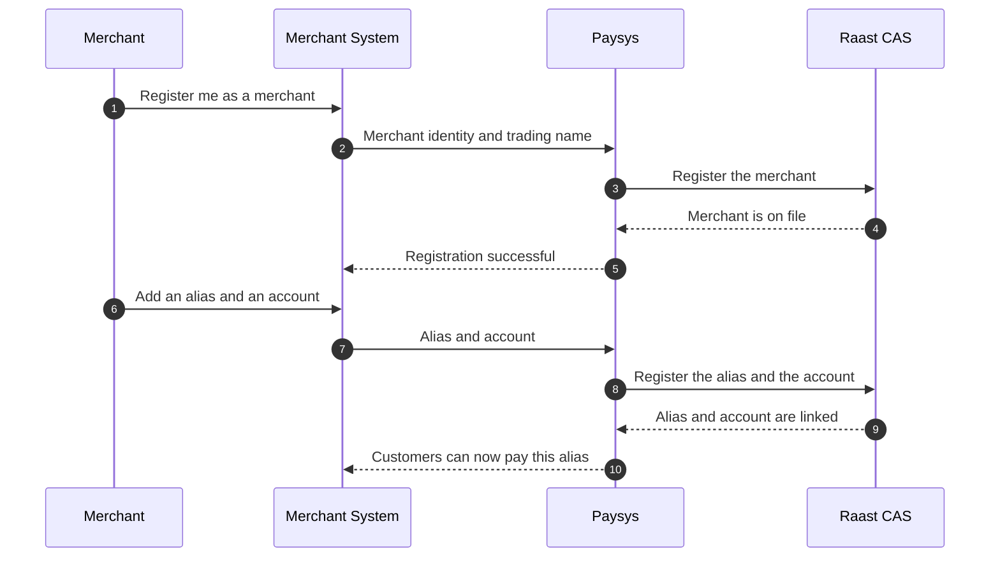
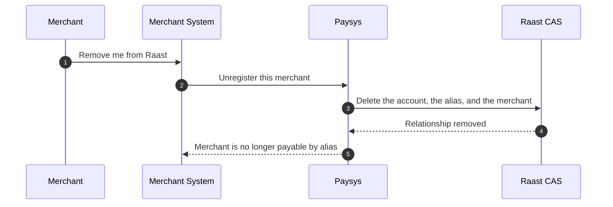
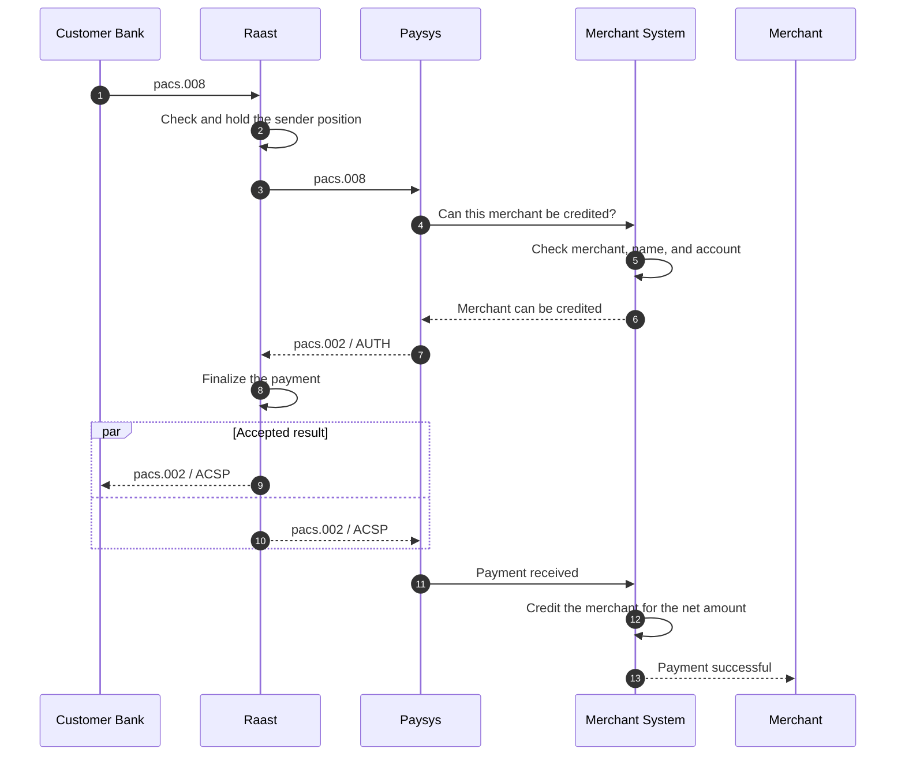
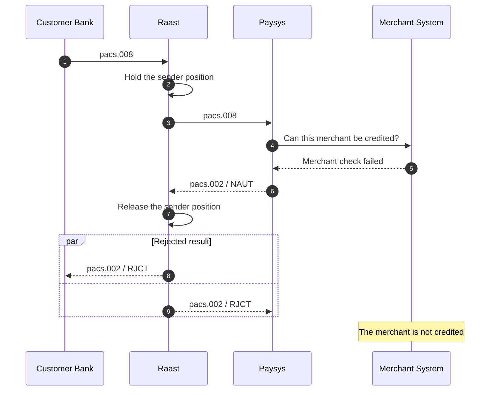
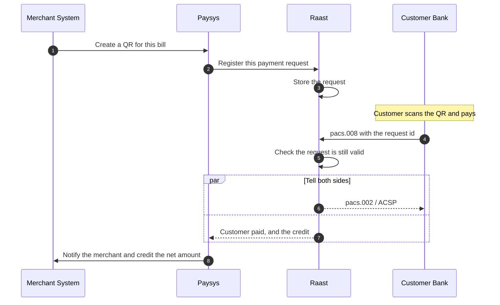
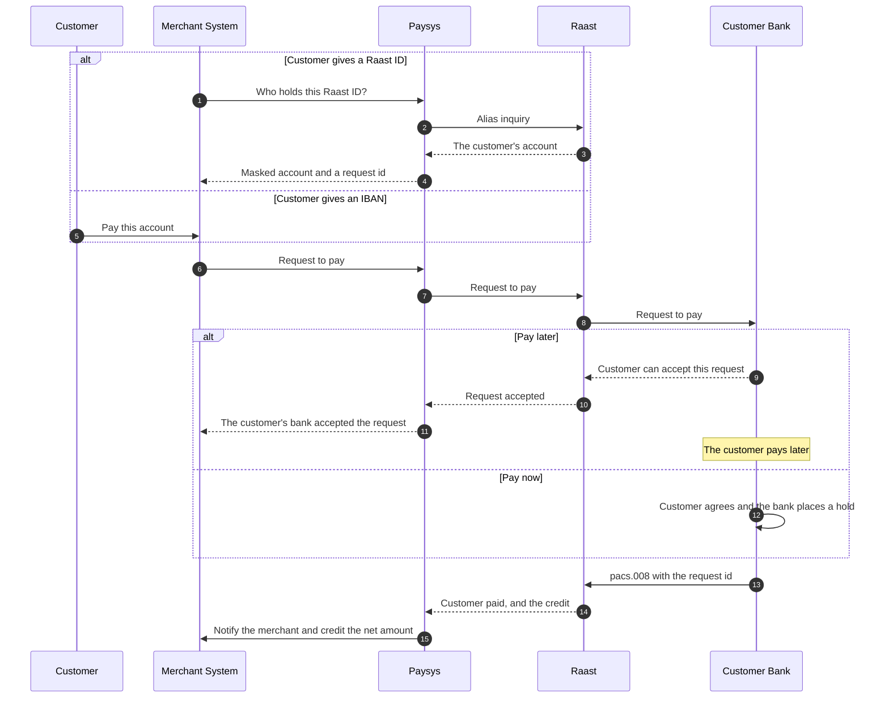
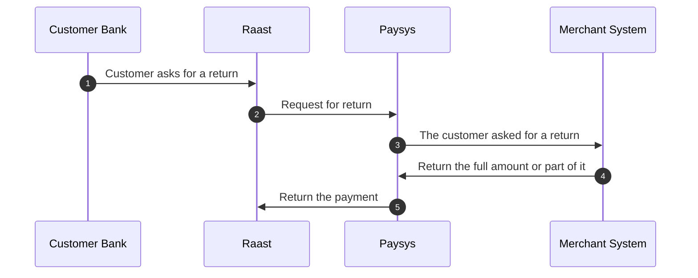
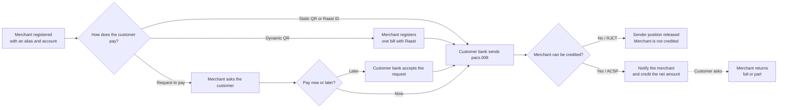

# Module 4 — Raast P2M Acquiring: An Overview

Read [Module 3 — Raast P2M Issuing](../03-p2m-issuing/03_Raast_P2M_Issuing_Overview.md) first. Issuing is the customer's bank paying a merchant. Acquiring is the merchant's bank receiving that payment and crediting the merchant.

Paysys is the Open Connect service between the merchant's bank and Raast. The merchant system is the bank's merchant management system. It knows the merchant, creates the QR or the request to pay, and credits the merchant after Raast accepts the payment.

## Learning objectives

By the end of this module, a new technical employee should be able to:

- Explain how a merchant is registered so a customer can pay by alias.
- Describe a static QR, including a QR that can be paid once.
- Describe an incoming customer payment, from the merchant check to the merchant credit.
- Explain a decline, and why the merchant is not credited.
- Describe a dynamic QR and a request to pay, now or later, from the merchant's side.
- Explain a return the merchant sends, and a return that comes back because the credit failed.

---

## 1. What this module adds

The customer journey is in Module 3. This module starts when the merchant is set up, and again when Raast brings a payment to the merchant's bank.

> **Registration answers: “How can a customer find this merchant?”**  
> **The incoming payment answers: “Can this merchant be credited?”**

`pacs.008`, `pacs.002/AUTH`, `pacs.002/ACSP`, `pacs.002/RJCT`, and `pacs.004` mean the same thing here as in Module 1. The new piece is the merchant check before the credit.

---

## 2. Register the merchant

A merchant that customers will pay by alias is registered in the Centralized Alias Service (CAS) through Paysys. The merchant is identified by a merchant CNIC, recorded as MCNIC, or by an NTN. A person already registered as a customer uses MCNIC so the merchant record stays separate.

The alias is what the customer can remember. It can be a merchant ID, a virtual payment address, or a till code for a customer who types it in. The alias is linked to the merchant account. One account can be marked as the default, so that is the account a lookup returns.

The merchant can link another of its own accounts to the same alias and choose which one is the default. Delinking removes one account from the alias. The alias itself can be activated, suspended, or deleted. Suspending it stops customers paying that alias until it is activated again.

Removing the merchant from Raast is one step. Paysys asks CAS to delete the account, the alias, and the merchant.

---

## 3. A static QR

The merchant, or an aggregator acting for the merchant, creates a QR and shows it to the customer. The QR can include an amount, or the customer can enter one.

A multi-use QR stays available for the next customer. A single-use QR carries a reference. The merchant system stores that reference. When the payment arrives, the reference is checked. A reference already paid is not accepted again. After a successful payment, that reference is marked complete.

The customer scan and the debit are the issuing journey in Module 3. The merchant's bank joins the story when Raast delivers the payment.

---

## 4. Incoming customer payment

The customer's bank sends `pacs.008`. Raast checks the sender's position, holds that position for the amount, and sends the payment to the merchant's bank.

Paysys asks the merchant system to check the merchant before it accepts the credit. The check covers whether the merchant is registered, whether the trading name matches, whether the account can be credited, and whether a wallet or Asaan account still has room for the credit. A single-use QR is also checked against its reference.

When the check passes, Paysys answers Raast with `pacs.002/AUTH`. Raast finalizes the payment and sends `pacs.002/ACSP` to both banks. Paysys then tells the merchant system. The merchant system notifies the merchant, works out the net amount, and credits the merchant under the settlement arrangement with the bank.

---

## 5. When the merchant cannot be credited

If the merchant check fails, Paysys answers Raast with `pacs.002/NAUT`. Raast releases the sender position it had held and sends `pacs.002/RJCT` to both banks. The merchant is not credited.

A credit that is accepted and then cannot be posted is returned. Paysys tells the merchant that the payment came back. That return is separate from a return the merchant chooses to send.

---

## 6. A dynamic QR

At a counter or at checkout, the merchant creates a QR for one bill. The merchant system gives that QR a request id. Paysys registers the request with Raast. Raast stores it. This request is not sent to the customer's bank.

The customer scans the QR and pays, and the customer's bank includes the request id. Raast checks that the request is still valid. It tells the merchant's bank that the customer paid, and it sends the credit. The customer's bank receives `pacs.002/ACSP` and confirms the customer's debit.

Paysys collects both messages and tells the merchant system. The merchant is notified, and the merchant account is credited for the net amount.

---

## 7. Request to pay

Online, the customer can ask the merchant to request the payment instead of scanning a QR. The request can use the customer's Raast ID or the customer's IBAN, and it can be pay now or pay later.

When the customer gives a Raast ID, the merchant system asks Paysys who holds it. Paysys returns a masked account and a request id. The full account stays with Paysys, and that request id is what the merchant sends back. When the customer gives an IBAN, the merchant system sends the request directly.

**Pay now.** Paysys sends the request to Raast. The customer's bank fetches it within the allowed time and asks the customer. If the customer pays, the customer's bank sends `pacs.008` with the request id. Raast checks the request, tells the merchant's bank the customer paid, and sends the credit. The merchant system notifies the merchant and credits the net amount.

**Pay later.** The customer's bank first confirms the customer can accept the request on a digital channel. Paysys tells the merchant system that the request was accepted. The credit waits until the customer pays. That later payment then follows the same credit path as pay now.

---

## 8. Returns

A customer can ask for money back. Paysys notifies the merchant of that request. The merchant can return the full amount or part of it. Paysys sends that return to Raast against the original payment. The customer's bank then credits the customer, as described in Module 3.

---

## 9. End-to-end mental model

---

## 10. Terms that are specific to this module

Shared message names are defined in Module 1. The customer side of these payments is defined in Module 3.

| Term | Meaning in this module |
|---|---|
| Acquiring | The merchant's bank. It checks the merchant and credits the merchant |
| Merchant system | The bank system that holds merchant records, creates QR and payment requests, and credits the merchant |
| Paysys | Open Connect for the acquiring bank. It registers the merchant and receives the credit from Raast |
| MCNIC | The identification type used when a merchant is registered with a CNIC |
| Merchant alias | A merchant ID, a virtual payment address, or a till code linked to a merchant account |
| Default account | The account a lookup returns for that alias |
| Static QR | A QR the merchant can show again. A single-use QR also carries a reference that can be paid once |
| Dynamic QR | A QR for one bill. Raast stores the request, and the customer's bank is not sent the request in advance |
| Request to pay | The merchant asks the customer to pay now, or the customer's bank first accepts a later payment |
| Net amount | The amount the merchant system credits after it applies the arrangement with the bank |

---

## 11. What to remember

1. Read **Module 3** for the customer paying. This module is the **merchant's bank receiving**.
2. A merchant paid by alias is registered in **CAS** through Paysys, with an alias and a default account. MCNIC keeps a merchant CNIC separate from a customer CNIC.
3. An incoming payment is checked before **`pacs.002/AUTH`**. Raast then sends **`pacs.002/ACSP`**. The merchant system notifies the merchant and credits the **net amount**.
4. A failed merchant check is **`pacs.002/NAUT`**, then **`pacs.002/RJCT`**. The merchant is not credited.
5. A **dynamic QR** is registered with Raast and is not sent to the customer's bank until the customer scans and pays.
6. A **request to pay** can start from a Raast ID. The merchant sees a masked account. Pay later is accepted by the customer's bank before the money moves.
7. The merchant can return the **full amount or part of it**. A credit that cannot be posted comes back as a return as well.
