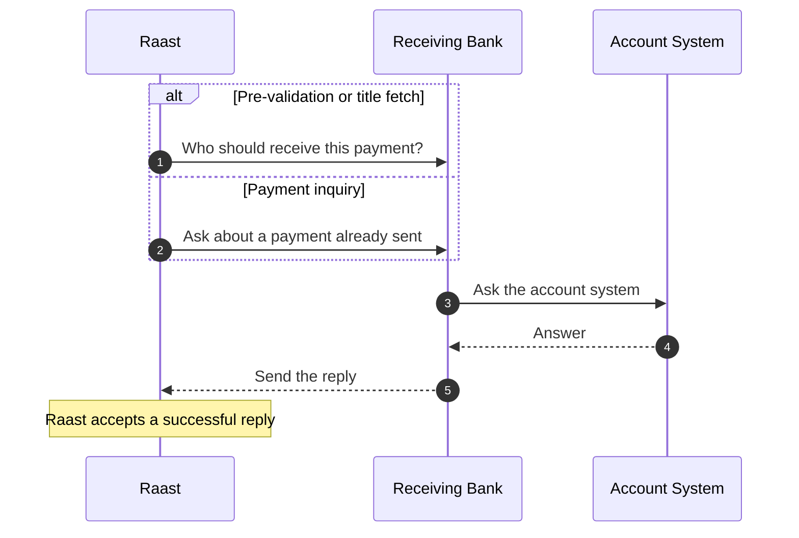
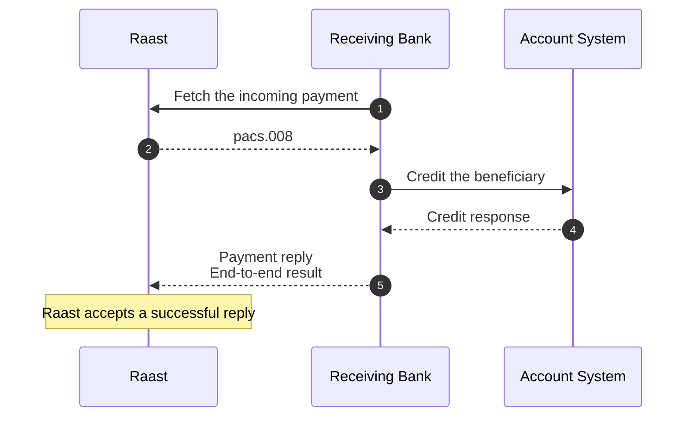
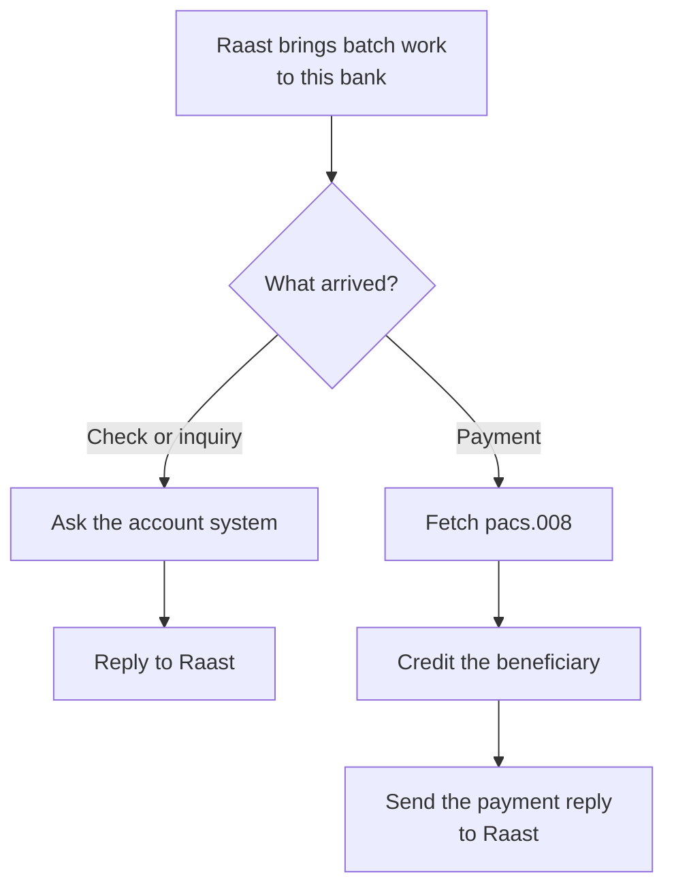

# Module 5 — Raast Bulk Receiving: An Overview

Read [Module 1 — Raast P2P Payment](../01-p2p/01_Raast_P2P_Payment_Overview.md) and [Bulk Sending](05_Raast_Bulk_Sending_Overview.md) first. Sending is this bank handing a batch to Raast. Receiving is Raast bringing another bank's batch to this bank.

This overview covers the phase 1 receiving flows in the supplied material. A batch can carry person-to-person payments or person-to-merchant payments. The incoming steps below are the same for both.

The receiving bank sees three kinds of incoming work:

- **Pre-validation or title fetch** — who should receive a payment in the batch.
- **Payment** — credit that beneficiary.
- **Payment inquiry** — a later question about a payment already sent. It travels the same path as the title check.

## Learning objectives

By the end of this module, a new technical employee should be able to:

- Explain bulk receiving as Raast bringing another bank's batch to this bank.
- Describe an incoming check, from Raast's question to the reply.
- Describe an incoming payment, from the fetched `pacs.008` to the credit and the reply.
- Explain that a payment inquiry uses the same request-and-reply path as a title check.

---

## 1. What this module adds

On a single payment in Module 1, the beneficiary bank validates the account and then credits it. Bulk receiving is that work arriving from Raast for a batch, in two separate conversations.

> **An incoming check answers: “Can this beneficiary be paid?”**  
> **An incoming payment answers: “Credit this beneficiary, then tell Raast.”**

The account system is the bank host that knows the customer account. The receiving bank asks the host, then answers Raast.

---

## 2. Incoming check

Raast asks the receiving bank about a beneficiary, or about a payment already sent. The bank asks its account system, then sends the answer back.

A successful answer is the pre-validation reply. Raast accepts that reply.

---

## 3. Incoming payment

The receiving bank fetches the incoming payment from Raast. That payment is `pacs.008`.

The bank then asks the account system to credit the beneficiary. When the account system answers, the bank sends the payment reply to Raast. A successful reply is the end-to-end result, and Raast accepts it.

The fetch and the credit are separate. The bank collects `pacs.008` from Raast, and only then asks the account system to credit.

---

## 4. End-to-end mental model

---

## 5. Terms that are specific to this module

Shared terms such as `pacs.008` and title fetch are defined in Module 1. The batch itself is defined in [Bulk Sending](05_Raast_Bulk_Sending_Overview.md).

| Term | Meaning in this module |
|---|---|
| Incoming check | Pre-validation or title fetch. Raast asks who should receive a payment |
| Payment inquiry | A later question about a payment already sent. Same path as the incoming check |
| Account system | Bank host that answers the check and posts the credit |
| Payment reply | Result the receiving bank sends to Raast after the credit |

---

## 6. What to remember

1. Read **Bulk Sending** for the batch this bank submits. This module is the batch **Raast brings here**.
2. An incoming **check or inquiry** goes to the account system, and the answer goes back to Raast.
3. An incoming **payment** starts when the bank fetches **`pacs.008`**.
4. The bank credits the beneficiary, then sends the **payment reply** to Raast.
5. A successful reply is accepted by Raast. The check and the credit stay separate conversations.
