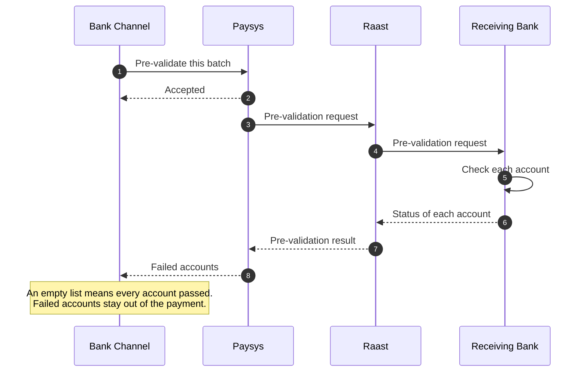
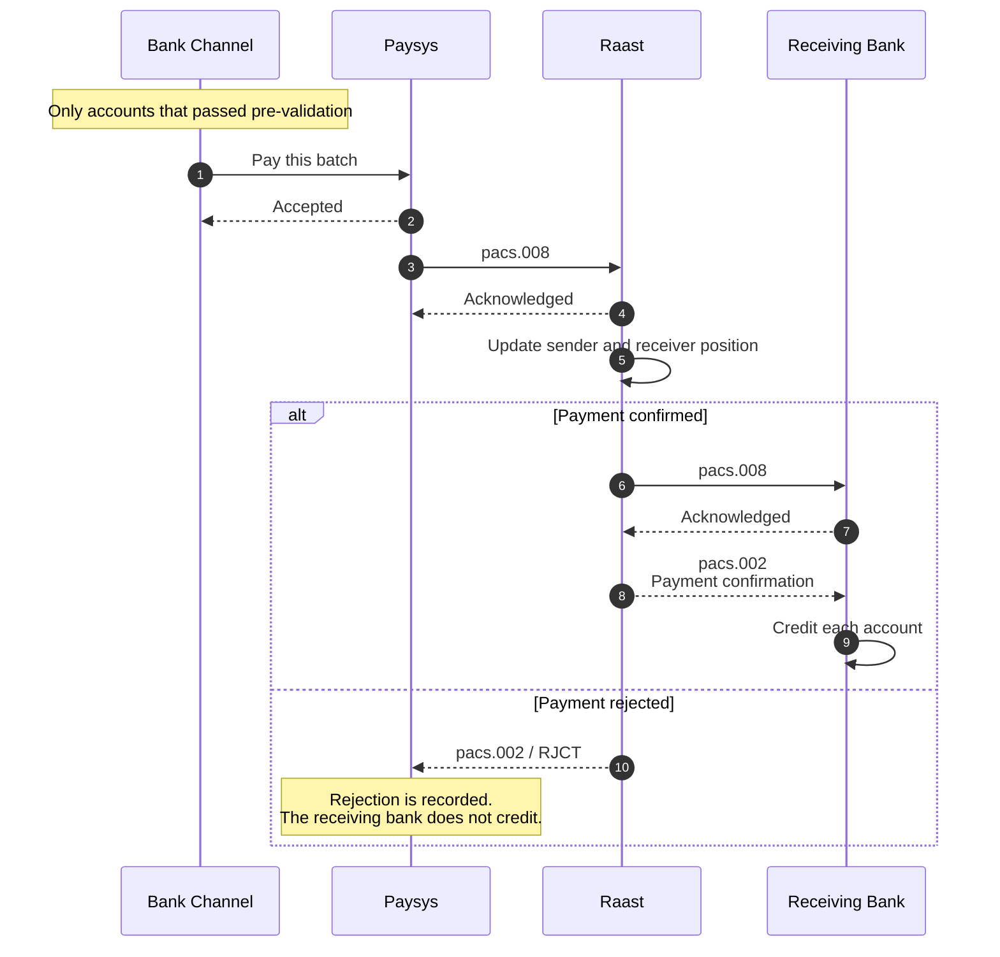
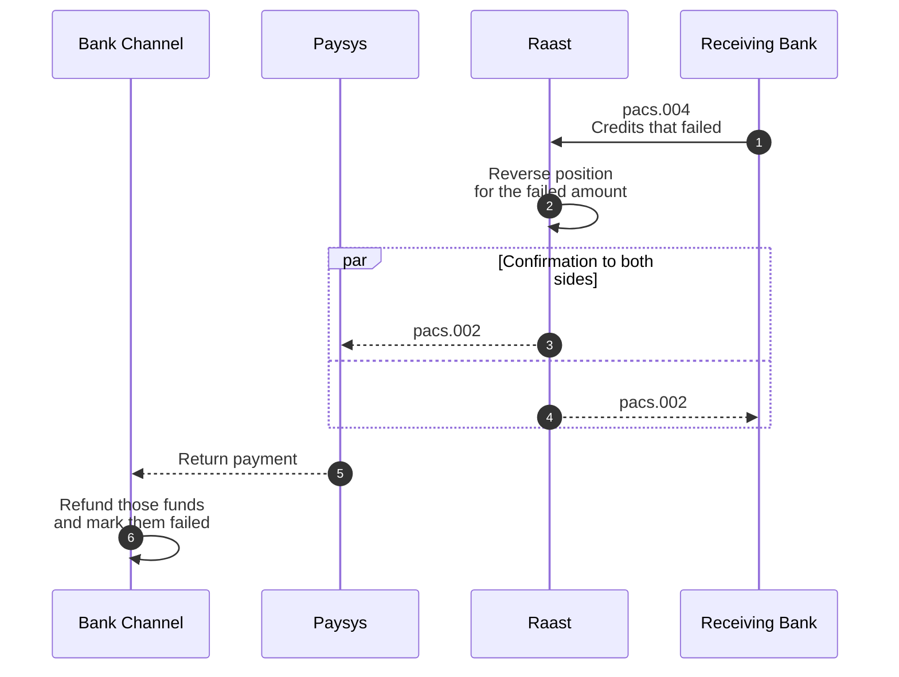
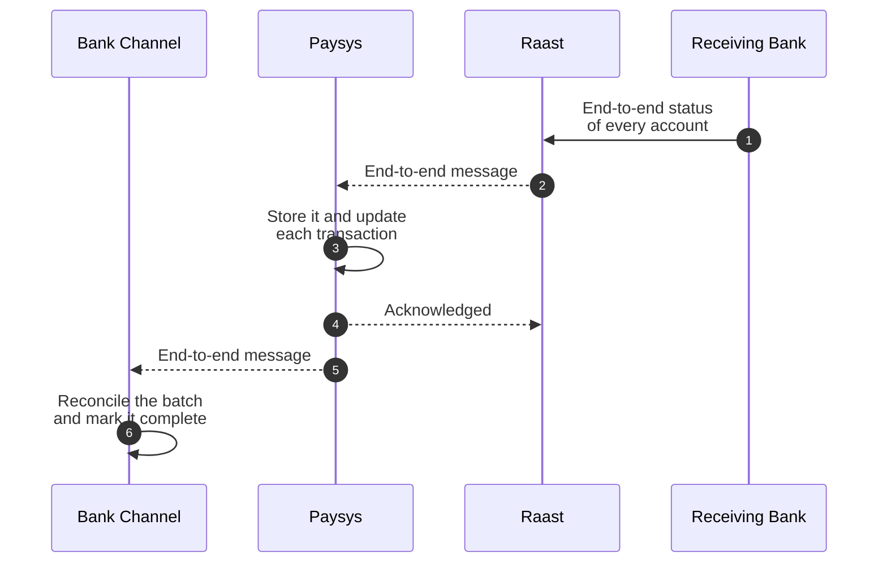
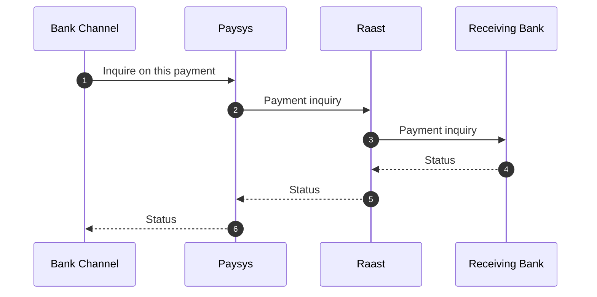
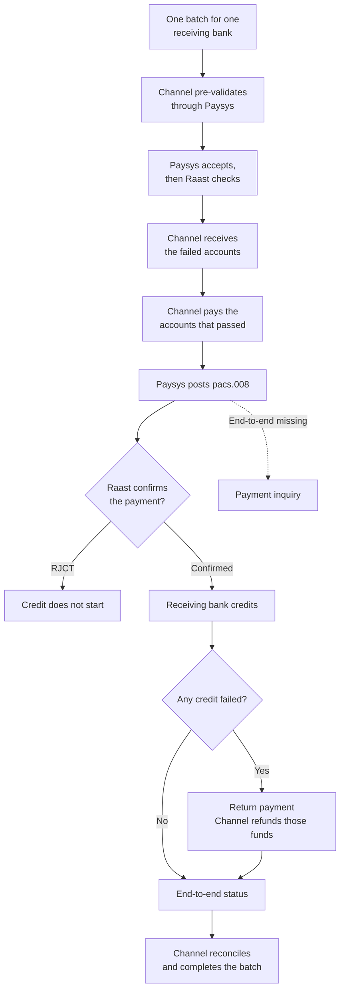

# Module 5 — Raast Bulk Sending: An Overview

Read [Module 1 — Raast P2P Payment](../01-p2p/01_Raast_P2P_Payment_Overview.md) first. That module is one payment. Bulk sending is many payments submitted together: salaries, pensions, dividends, or other corporate payments.

A bank that uses Paysys does not post the batch straight to Raast. The bank's channel calls Paysys. Paysys accepts the call, posts the batch to Raast, and later brings Raast's answers back to the channel.

One batch goes to one receiving institution. A file for two receiving banks becomes two batches, and each batch is pre-validated and paid on its own. The same batch identity is used for the pre-validation and for the payment, so the two steps stay tied together.

Receiving the other side of a batch is covered in [Bulk Receiving](05_Raast_Bulk_Receiving_Overview.md).

## Learning objectives

By the end of this module, a new technical employee should be able to:

- Explain where the bank channel, Paysys, Raast, and the receiving bank sit in a bulk batch.
- Describe pre-validation, including the immediate acceptance and the later result.
- Describe how a payment is posted with `pacs.008`, and when the receiving bank starts crediting.
- Explain why a failed credit comes back as a return payment, and why that is the message that refunds the sender.
- Explain the end-to-end message as the status of every account, and when a payment inquiry is used.

---

## 1. What bulk sending is

The channel prepares the batch. Paysys is the Open Connect service that carries it. Raast clears it with the receiving bank.

Raast answers in separate messages. Paysys accepts the channel's call first, then forwards each later answer.

> **Pre-validation answers: “Which accounts in this batch can be paid?”**  
> **The payment answers: “Credit those accounts, and tell the sender what happened.”**

`pacs.008`, `pacs.002`, and `pacs.004` are the same message names as in Module 1. In this module they travel as a batch, with Paysys between the channel and Raast.

---

## 2. Pre-validation

The channel sends the batch to Paysys for a title check of every account. Paysys checks the call and accepts it straight away. That acceptance means Paysys has the batch. It is not the result of the account check.

Paysys then sends the pre-validation to Raast. Raast forwards it to the receiving bank. The receiving bank checks each account and returns the status. Raast passes that result to Paysys, and Paysys calls the channel.

The call to the channel lists the accounts that failed. An empty list means every account passed. The channel leaves the failed accounts out of the payment.

---

## 3. Post the payment

The channel sends Paysys only the accounts that passed. It completes its own accounting for that amount before the payment call.

Paysys accepts the call, builds `pacs.008`, and posts the batch to Raast. Raast acknowledges that post and updates the sender and receiver positions. Raast then sends `pacs.008` to the receiving bank.

The receiving bank acknowledges the batch. Raast sends that bank `pacs.002` as payment confirmation, and the receiving bank starts crediting the accounts.

If Raast rejects the payment, the sending side receives `pacs.002/RJCT` and the credit does not start.

---

## 4. Return a credit that failed

After the receiving bank tries to credit, any account it could not credit is returned with `pacs.004`. Raast reverses the position for that failed amount and sends `pacs.002` to both the sending side and the receiving bank.

Paysys turns that into a return payment and sends it to the channel. The channel refunds those funds and marks the transactions failed.

The return payment is the message that moves the money back. The end-to-end message in the next section can arrive earlier, and it leaves the refund waiting for this return.

---

## 5. End-to-end status

When the receiving bank finishes the batch, it sends Raast an end-to-end message: the status of every account. Raast sends that message to Paysys. Paysys stores it, acknowledges Raast, and delivers it to the channel.

The channel reconciles each account and marks the batch complete.

| Status | Meaning |
|---|---|
| Processed | The account was credited |
| Returned | The credit was returned |
| Suspended | The account is still outstanding |

This message reports status. The channel completes the batch from it. A refund still waits for the return payment in section 4, even when this message arrives first.

If the end-to-end message does not arrive, the channel can ask. A payment inquiry goes through Paysys to Raast, and the receiving bank returns the status of one payment or of the whole batch. The inquiry is for a payment batch.

---

## 6. End-to-end mental model

---

## 7. Terms that are specific to this module

Shared message names are defined in Module 1.

| Term | Meaning in this module |
|---|---|
| Channel | Bank system that submits the batch and receives Paysys's replies |
| Paysys | Open Connect. Accepts the channel's call, posts the batch to Raast, and returns Raast's answers |
| Batch | Many payments for one receiving institution |
| Pre-validation | Account check before payment. The channel is told which accounts failed |
| Return payment | Paysys's delivery of a `pacs.004` credit failure. This is the refund |
| End-to-end message | Status of every account. Completes the batch |
| Payment inquiry | Ask the receiving bank for the status of a payment when the end-to-end message has not arrived |

---

## 8. What to remember

1. The channel talks to **Paysys**. Paysys posts the batch to **Raast** and brings the answers back.
2. Paysys **accepts** a pre-validation or a payment immediately. The account check and the credit result arrive later.
3. Pre-validation returns the **failed accounts**. Those accounts stay out of the payment. One batch is for one receiving bank.
4. The payment is **`pacs.008`**. The receiving bank starts crediting when Raast confirms it. A rejection is **`pacs.002/RJCT`**.
5. A credit that fails comes back as a **return payment**. That message is what the channel refunds.
6. The **end-to-end message** reports Processed, Returned, or Suspended, and completes the batch. It can arrive before the return. If it never arrives, the channel sends a **payment inquiry**.
