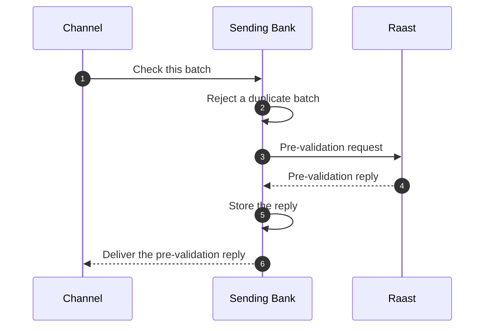
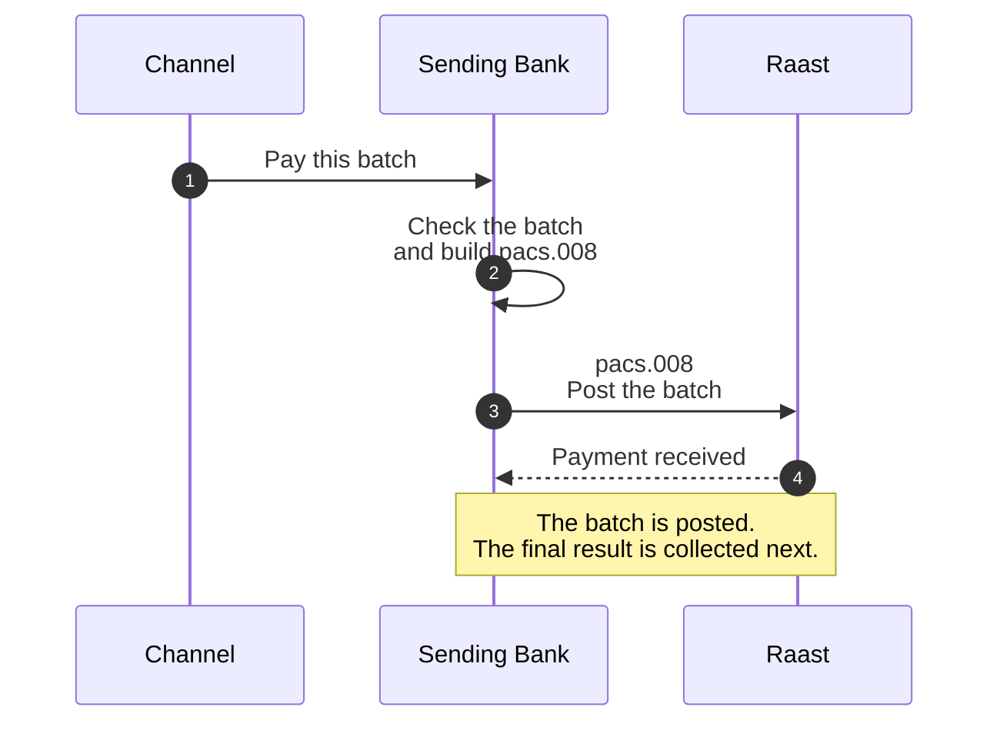
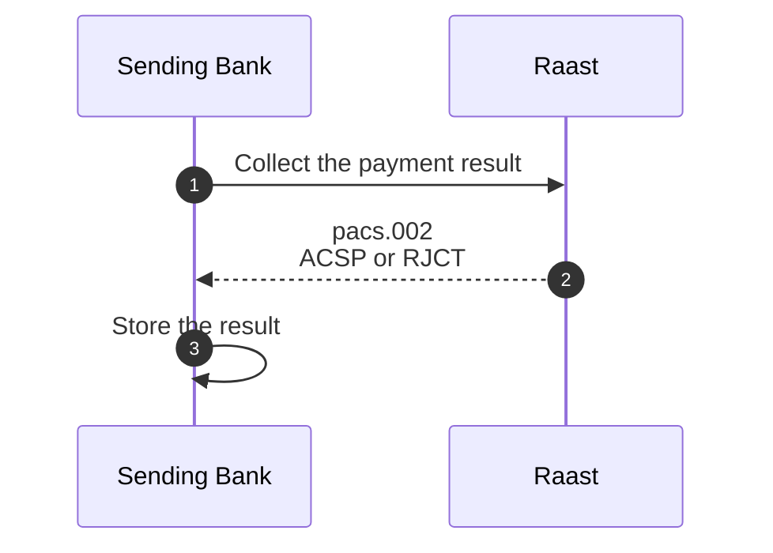
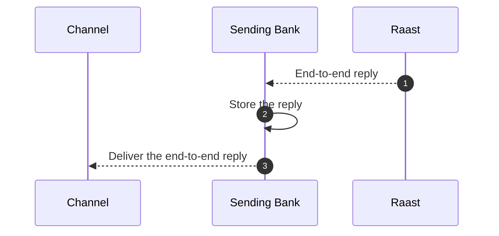
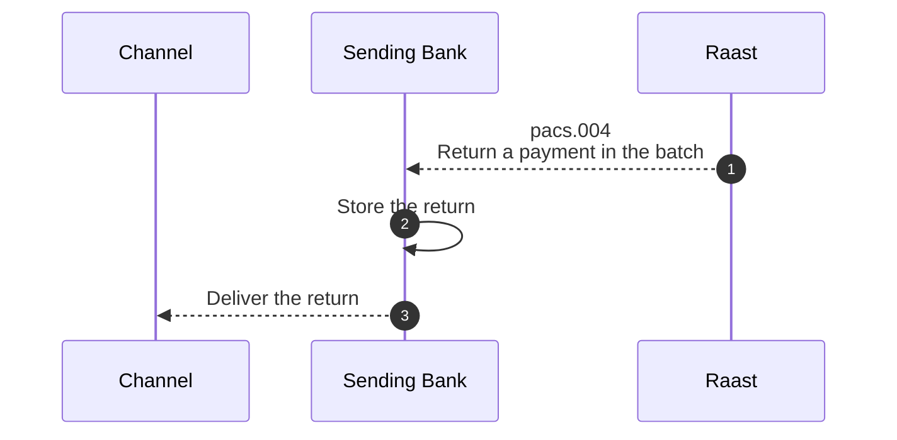
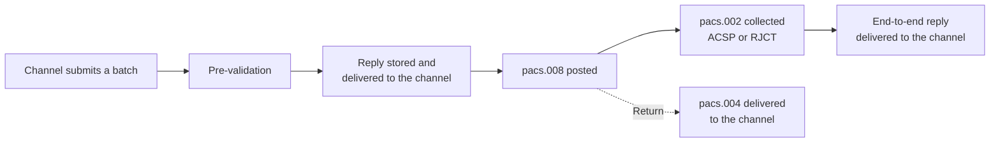

# Module 5 — Raast Bulk Sending: An Overview

Read [Module 1 — Raast P2P Payment](../01-p2p/01_Raast_P2P_Payment_Overview.md) first. That module is one payment: the bank sends `pacs.008`, then learns the result. Bulk sending is that same payment, submitted many times together as one batch.

The channel is the bank system that hands the batch over. A batch can carry person-to-person payments or person-to-merchant payments. This module follows the batch. Receiving the other side of a batch is covered in [Bulk Receiving](05_Raast_Bulk_Receiving_Overview.md).

## Learning objectives

By the end of this module, a new technical employee should be able to:

- Explain a bulk batch as many payments submitted together by a channel.
- Describe pre-validation, and why the channel receives that reply after the bank has stored it.
- Describe posting `pacs.008`, and why Raast's first acknowledgement still leaves the final result to be collected.
- Describe how the bank collects `pacs.002` as accepted (`ACSP`) or rejected (`RJCT`).
- Describe how the end-to-end reply, and a return, reach the channel.

---

## 1. What bulk sending is

A channel prepares a batch: many beneficiaries, one submission. The sending bank checks that batch, sends it to Raast, and brings each answer back to the channel.

Raast answers the batch in separate steps. The bank stores each answer, then delivers it.

> **Pre-validation answers: “Which items in this batch can be paid?”**  
> **The payment answers: “Did Raast accept each payment?”**

`pacs.008`, `pacs.002/ACSP`, `pacs.002/RJCT`, and `pacs.004` mean the same thing here as in Module 1 and the remittance module. What changes is that the channel waits while the bank stores the reply and delivers it.

---

## 2. Pre-validation

Before the money moves, the channel asks the bank to check the batch. The bank rejects a duplicate batch, then sends the pre-validation to Raast.

Raast's reply comes back to the bank. The bank stores it, and a later delivery carries that reply to the channel. The channel reads the reply from that delivery.

---

## 3. Post the batch

When the channel sends the batch for payment, the bank checks it again, builds `pacs.008`, and posts that payment to Raast.

Raast answers that the payment was received. That acknowledgement means the batch has been posted. The accepted or rejected result is collected in the next step.

---

## 4. Collect the result

The bank asks Raast for the payment result. Raast returns `pacs.002`.

- **`ACSP`** — Raast accepted the payment.
- **`RJCT`** — Raast rejected the payment.

The bank stores that result.

---

## 5. Deliver the end-to-end reply

Raast also sends the end-to-end reply to the bank. The bank stores it, then delivers it to the channel. This is the reply the channel keeps for the batch.

---

## 6. When Raast returns a payment

A payment in the batch can be returned with `pacs.004`. The bank treats that return like the other replies from Raast: store it, then deliver it to the channel.

---

## 7. End-to-end mental model

Read the batch from the channel's point of view. Each arrow below is one of the replies the bank stores and then delivers, except the posted payment and the result the bank collects.

---

## 8. Terms that are specific to this module

Shared terms such as `pacs.008`, `pacs.002/ACSP`, `pacs.002/RJCT`, and `pacs.004` are defined in Module 1 and the remittance module.

| Term | Meaning in this module |
|---|---|
| Batch | Many payments submitted together by a channel |
| Channel | Bank system that submits the batch and receives the replies |
| Pre-validation | Check of the batch with Raast before the payment is posted |
| End-to-end reply | Raast's reply for the posted batch, stored by the bank and delivered to the channel |

---

## 9. What to remember

1. Read **Module 1** for a single payment. Bulk sending repeats that payment across a **batch**.
2. **Pre-validation** checks the batch. The channel receives the reply after the bank stores it.
3. Posting **`pacs.008`** gets an acknowledgement that Raast received the batch. The final result is still to be collected.
4. The bank collects **`pacs.002`** as **`ACSP`** or **`RJCT`**.
5. The **end-to-end reply**, and a **`pacs.004` return**, are stored and then delivered to the channel.
