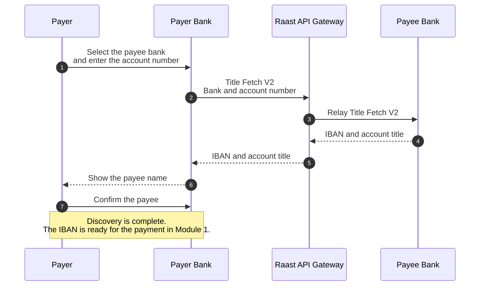
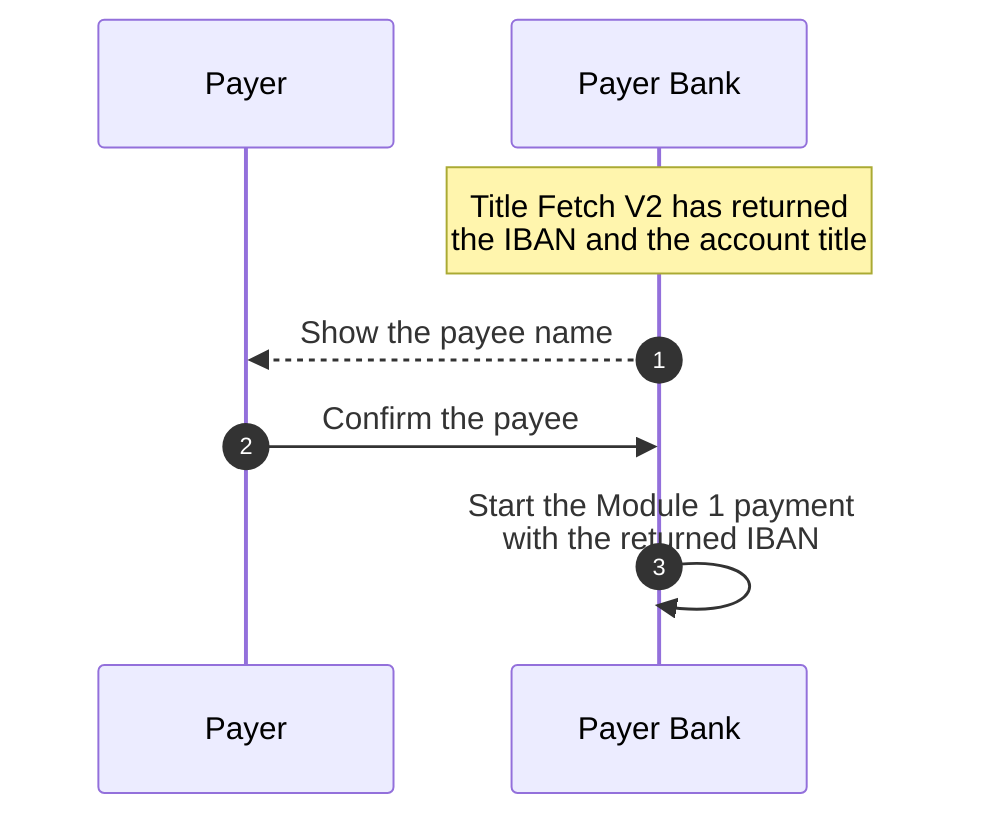
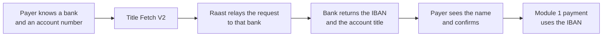

# Module 6 — Raast Title Fetch V2: An Overview

Read [Module 1 — Raast P2P Payment](../01-p2p/01_Raast_P2P_Payment_Overview.md) first. That module explains the three ways a payer finds a payee, and the payment that follows. This module is only the third way: the payer knows a bank and a legacy account number, and does not have an IBAN.

Title Fetch V2 asks that bank, through Raast, for the IBAN and the account title. The payer sees the name before confirming. The IBAN is then available for the payment in Module 1.

## Learning objectives

By the end of this module, a new technical employee should be able to:

- Explain when a payer uses Title Fetch V2 instead of a Raast ID or an IBAN.
- Describe the request the payer bank sends, and the two facts that come back.
- Explain why the payer confirms the name before the payment starts.
- Point to Module 1 for the payment that uses the returned IBAN.

---

## 1. What this module adds

Discovery answers who will receive the money. Payment answers whether the money can move. Title Fetch V2 is discovery only.

A Raast ID is resolved by the Centralized Alias Service. An IBAN is checked with a Title Fetch, which returns the account title. Title Fetch V2 is the path for a local account number. The payer also names the destination bank, because the account number alone does not say which institution holds it.

> **Title Fetch V2 answers: “Who owns this account at this bank, and what is the IBAN?”**  
> **The payment in Module 1 answers: “Can the money be sent to that IBAN?”**

| Payer knows | Where this is covered | Main result |
|---|---|---|
| Raast ID / mobile alias | [Module 1, alias discovery](../01-p2p/01_Raast_P2P_Payment_Overview.md) | IBAN, destination institution, and beneficiary information. A Title Fetch on that IBAN is optional |
| IBAN | Module 1, Title Fetch | Account title |
| Bank + account number | This module, Title Fetch V2 | IBAN and account title |

---

## 2. The Title Fetch V2 request

The payer selects the payee's bank and enters the account number. The payer bank sends a Title Fetch V2 to Raast's API Gateway. The request carries the destination bank and the account number.

The gateway relays the request to the payee's bank. That bank returns the IBAN and the account title. The gateway passes both back to the payer bank.

The payer bank shows the payee's name. The payer confirms that this is the person who should receive the money. Discovery is then complete, and the IBAN can be used on the payment leg in Module 1.

The account title is what the payer checks. The IBAN is what the later payment uses. Both come back from the same request.

---

## 3. After the payer confirms

Confirmation ends discovery. It does not move the money. The payer bank continues with the push payment in Module 1, using the IBAN returned here.

A Raast ID lookup and an IBAN Title Fetch also end by showing a name and waiting for confirmation. Those journeys are drawn in Module 1. They are separate from Title Fetch V2 because the payer started with different information.

---

## 4. End-to-end mental model

---

## 5. Terms that are specific to this module

Shared terms such as Raast ID, CAS, IBAN, and Title Fetch are defined in Module 1.

| Term | Meaning in this module |
|---|---|
| Legacy account number | A local account number the payer has, together with the destination bank |
| Title Fetch V2 | The discovery request that sends that bank and account number, and returns the IBAN and the account title |
| Raast API Gateway | The Raast path that relays the Title Fetch V2 to the payee bank and brings the answer back |
| Account title | The name returned for the account, shown to the payer before confirmation |
| Payee bank | The institution that holds the account and answers the Title Fetch V2 |

---

## 6. What to remember

1. Read **Module 1** for a Raast ID, an IBAN Title Fetch, and the payment after discovery.
2. **Title Fetch V2** is for a payer who knows a **bank and a legacy account number**.
3. The payee bank returns the **IBAN and the account title**. The payer confirms the name before any payment.
4. The returned **IBAN** is what the Module 1 payment uses.
5. Title Fetch 2.0 Bulk is a separate module and is not covered here.
