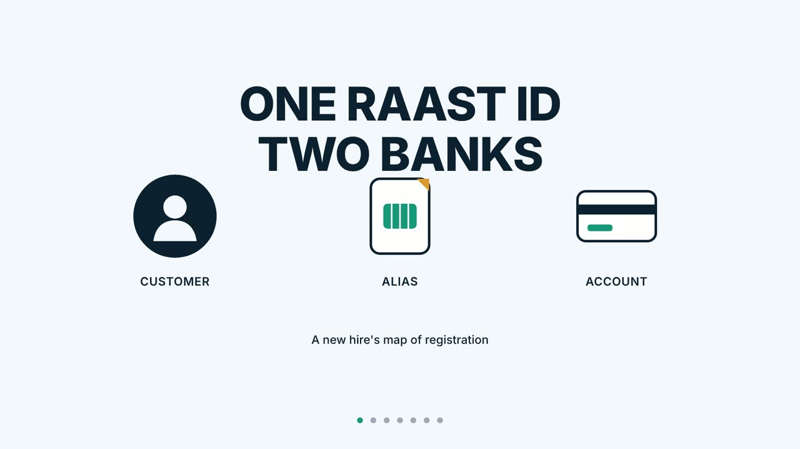
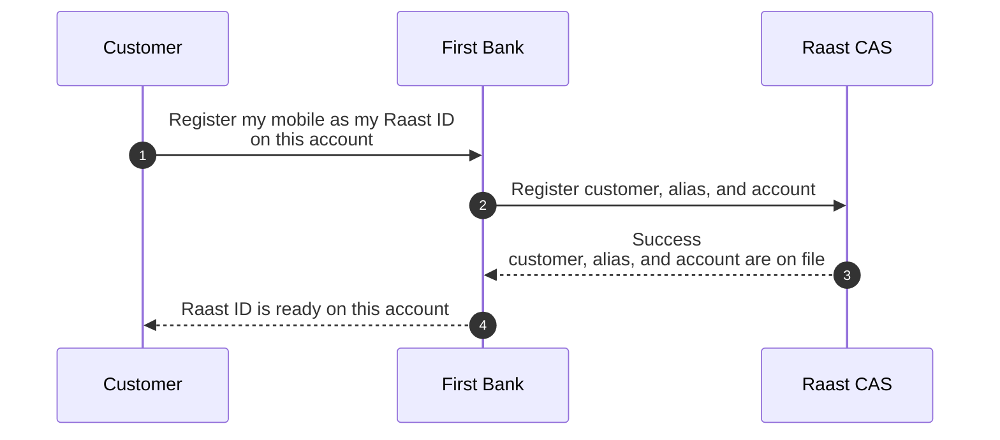
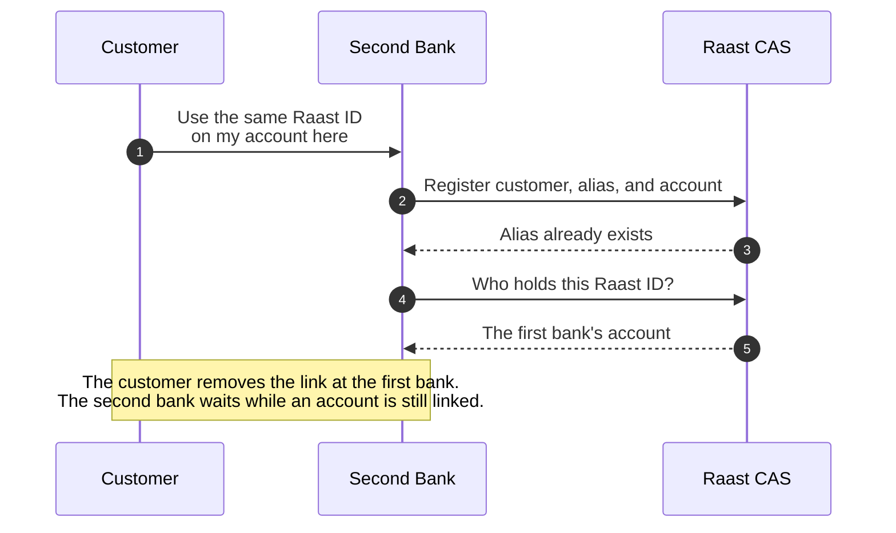
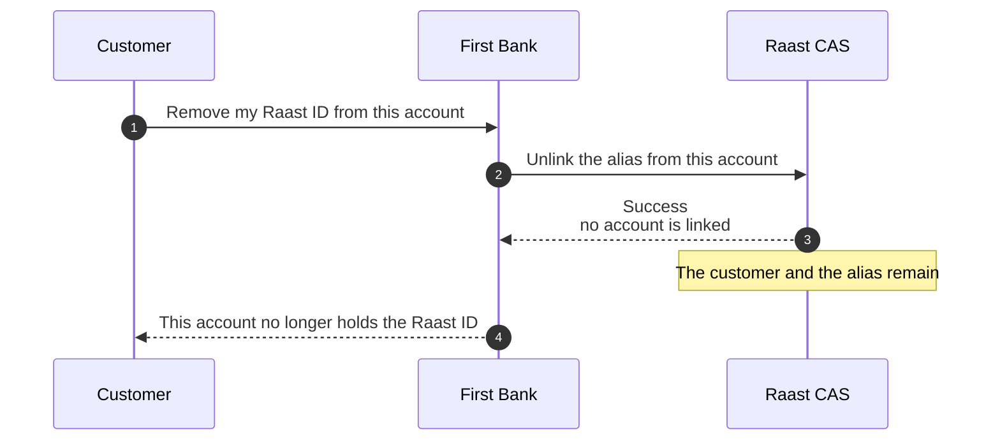
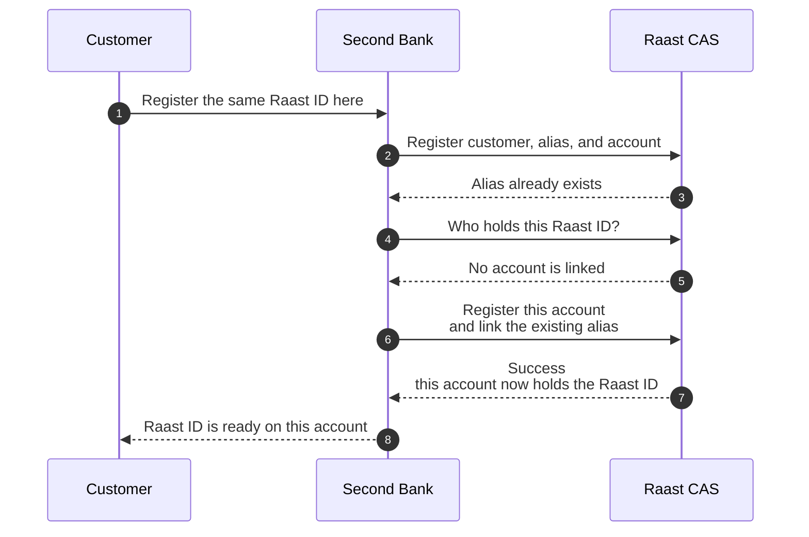
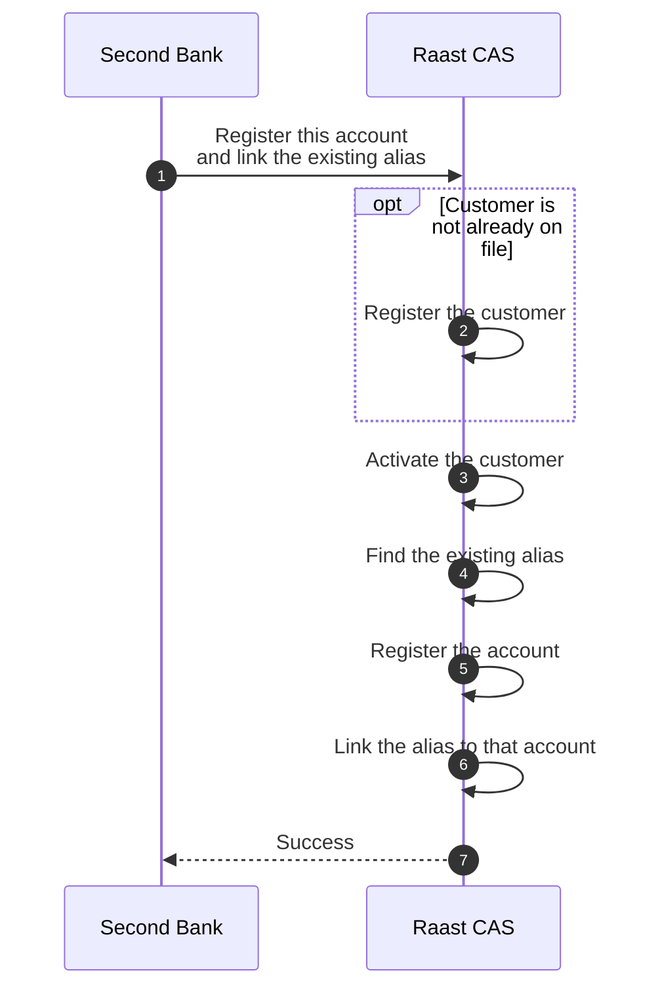
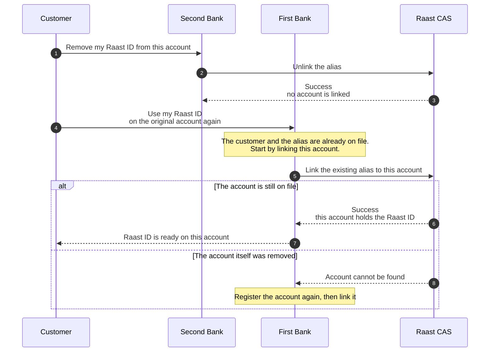
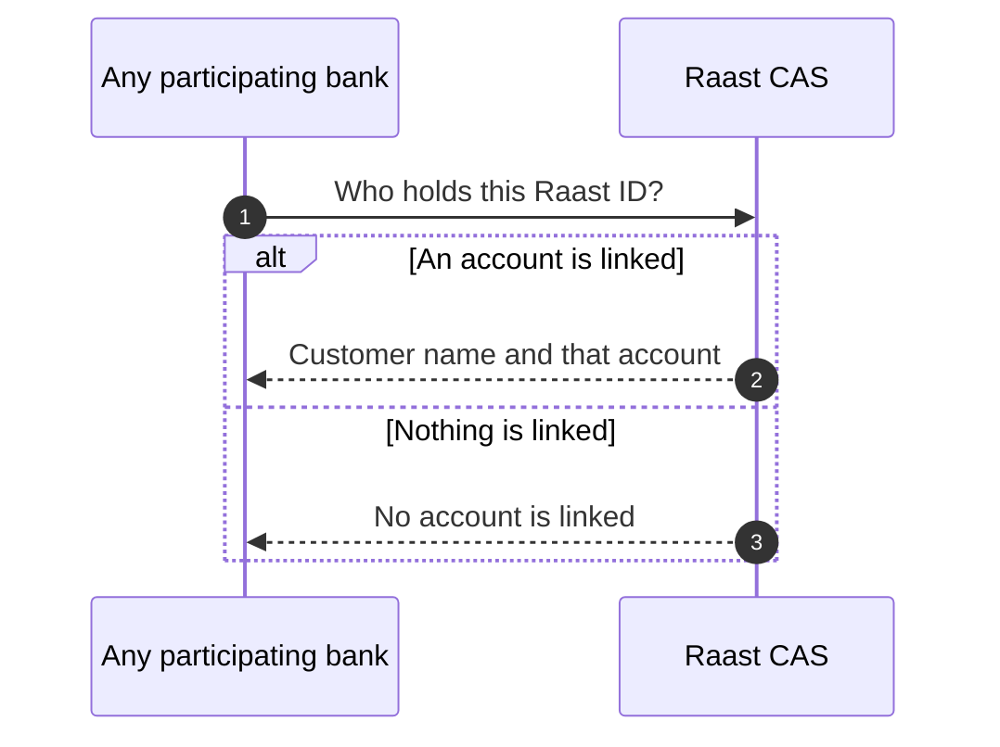
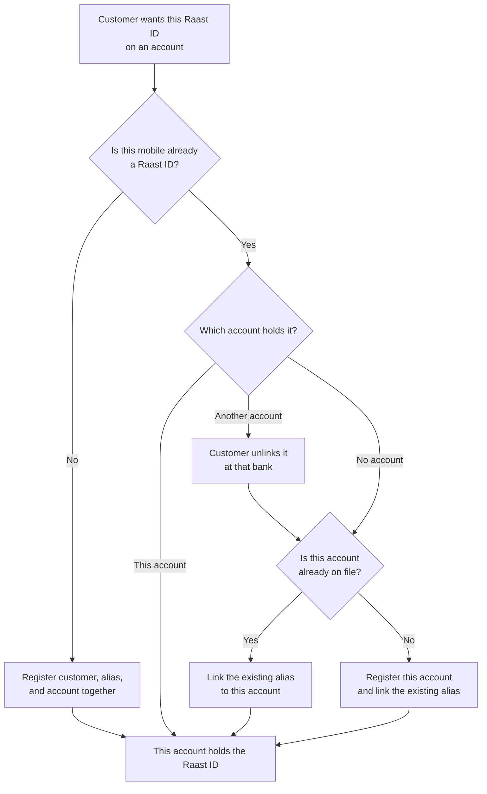

# Module 8 — Raast Alias Management: An Overview

Read [Module 1 — Raast P2P Payment](../01-p2p/01_Raast_P2P_Payment_Overview.md) first. That module explains what a Raast ID is, and how a payer looks one up before sending money. This module covers how a bank registers that Raast ID, and how the customer moves it from one account to another.

A Raast ID is an alias. In this training the alias is the customer's mobile number. It points at **one account at a time**. The Centralized Alias Service (CAS) is the directory that stores the customer, the alias, and the account that currently holds it.

## Watch the flows

Select the picture to play Raast Alias Management Flows. It is a short visual walkthrough of this module. Watch it before the sections below. The written flow is the same story.

## Learning objectives

By the end of this module, a new technical employee should be able to:

- Explain that a Raast ID points at one account at a time, and that the customer chooses which account that is.
- Describe first registration, when the bank creates the customer, the alias, and the account together.
- Explain why a second bank waits while another account still holds the alias.
- Describe what remains after the link is removed.
- Explain when the second bank registers its account and links the existing alias.
- Explain when a bank links an account that is already on file, instead of registering the customer again.

---

## 1. What this module adds

Module 1 answers a payer's question: "Who does this mobile number pay?" The payer's bank asks CAS, and CAS returns the account that currently holds the alias.

This module answers the customer's question: "Which of my accounts should that mobile number pay?"

The customer does this through a participating bank. The bank talks to CAS. Another bank can see which account holds the alias, including an account open at a different institution. That lookup is the same directory Module 1 uses before a payment.

> **Lookup answers: “Which account holds this Raast ID right now?”**  
> **Registration and linking answer: “Which account should hold it?”**

The customer is already identified by the CNIC they present. Registration stores three related records: the customer, the alias, and the account. The CNIC is the identity that was supplied with those records.

---

## 2. First registration

The first time this mobile number is used as a Raast ID, the customer's bank registers everything in one step: the customer, the alias, and the account that will hold it.

After this step, a lookup of the mobile number returns this account. A later attempt to register the same mobile number again hears that the alias already exists. CAS keeps the alias already on file.

---

## 3. A second account while the first is still linked

The customer can hold an account at another bank and ask that bank to use the same Raast ID. While the first account is still linked, the second bank stops.

It tries to register, and CAS reports that the alias already exists. It then asks who holds the alias, and CAS returns the first account. The second bank does not register its own account yet. The customer removes the link at the first bank first.

---

## 4. Removing the link

The customer asks the bank that currently holds the Raast ID to remove it from that account. CAS unlinks the alias from the account.

The customer and the alias stay in CAS. What changes is the pointer: no account is the default for that mobile number. A lookup now finds no linked account.

The account itself can remain on file after the unlink. That matters when the customer comes back to it later.

---

## 5. Registering the second account

The customer returns to the second bank. Registering from scratch still reports that the alias already exists, because the mobile number was never deleted. The lookup now finds no linked account, so the alias is free.

The second bank then makes one call: register this account and link the existing alias to it. That call is the path to use only when both of these are true:

1. Registration reported that the alias already exists.
2. The lookup found no account linked to that alias.

The bank makes one call. CAS carries out the steps behind it. When the customer is already known, CAS skips creating the customer and starts by activating that customer.

A lookup of the mobile number now returns the second bank's account.

---

## 6. Linking an account that is already known

The customer can move the Raast ID back to the first account. They unlink it at the second bank. The first bank then links the alias to the account it already holds.

This return starts at link, because the customer and the alias are already on file. Link succeeds when that account is still on file. If the account itself was removed, CAS cannot find the account, and the bank registers the account again before it can be linked.

---

## 7. Who can see the current account

Any participating bank can ask which account a Raast ID points at. The account may be open at another institution. When an account is linked, the answer includes the customer's name and that account. When nothing is linked, the answer is that no account can be found.

This is the lookup a second bank uses before it registers, and the same directory a payer's bank uses in Module 1 before a payment.

---

## 8. End-to-end mental model

Follow the alias. The next step depends on whether the mobile number is already a Raast ID, whether an account currently holds it, and whether this account is already on file.

---

## 9. Answers that change the next step

The diagrams above use the plain meaning. These are the answers a bank sees on this flow.

| Answer | What it means | What the bank does next |
|---|---|---|
| Success | The step completed | Continue |
| Alias already exists | This mobile is already a Raast ID | Ask which account holds it |
| An account is linked | A specific account currently holds it | The customer unlinks that account before another bank registers |
| No account is linked | The alias is free | Register a new account, or link an account already on file |
| Account cannot be found | That account is not on file | Register the account, then link it |
| Account already linked | This account already holds the alias | No further link is required |
| Account is not linked to the alias | The account and the alias are both known, and they are not joined | Link them |

Customer already exists is handled inside the register-and-link call: CAS skips creating the customer and continues with the customer it already holds.

---

## 10. Terms that are specific to this module

Shared terms such as Raast ID and participant are defined in Module 1.

| Term | Meaning in this module |
|---|---|
| Alias | The Raast ID. In this training, the customer's mobile number |
| CAS | Centralized Alias Service. The directory of customers, aliases, and the account each alias points at |
| One-step registration | The first registration. One bank call stores the customer, the alias, and the account |
| Default account | The one account that currently holds the alias |
| Delink | Remove the alias from an account. The customer and the alias remain |
| Register and link | One bank call used when the alias exists, no account is linked, and this account is not on file yet |
| Link | Attach an existing alias to an account that is already on file |

---

## 11. What to remember

1. Read **Module 1** for how a payer resolves a Raast ID. This module is how that Raast ID is registered and moved.
2. A Raast ID points at **one account at a time**.
3. **First registration** stores the customer, the alias, and the account together.
4. While an account is still linked, the customer **unlinks it there** before another bank registers.
5. After the unlink, the customer and the alias **remain**. The second bank registers its account and links the existing alias.
6. Moving back to an account that is already on file **starts at link**.
